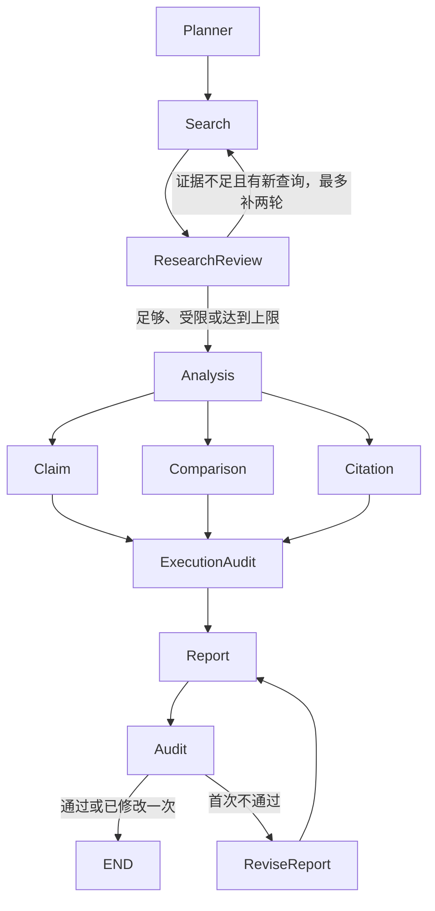

# 人智协作复核与离线评测

本功能只增加后端记录与接口，不自动复核或覆盖已有报告。迁移 `044_human_ai_review` 新建两个项目隔离表；检索实验保留历史数据集 ID，不阻止删除数据集；没有回填或修改历史报告、运行。权限沿用现有 `atlas_project_access`：reader 可读，任务中所称 writer 对应项目现有 `analyst`，analyst 和 owner 可写，不新增角色。

## 结论与复核模型

`GET /api/reports/:id/conclusions?version=0` 以保存的报告快照解析 Markdown 段落、列表内段落、引用内段落；一张表作为一个条目，标题、代码和纯图表标记不单独作为结论。返回字段：

| 字段 | 含义 |
| --- | --- |
| id | `报告ID:v版本:p段落序号`；同一不可变快照下稳定，不依赖内容哈希 |
| revision | 0 为保存原版，正整数为指定草稿；省略始终为 0 |
| section / sectionTitle | 现有章节解析器的键和标题，重复标题按出现次数区分 |
| text / start / end | 快照中的原文及 JS 字符偏移（end 不包含） |
| patentNumbers | 条目明文出现的规范化公开编号 |
| resultIds / tools | 显式图表引用、或其明文编号能在工具证据中找到的运行结果及工具 |
| previousId | 与上一版同章节、同原文的条目精确关联；重复段落按出现次序匹配 |

独立成段的图表标记关联同章节前一条结论。没有显式关联的段落保持空证据列表。自动编号识别针对 `US123001B1`、`CN123456789A` 等“两字母公开局＋数字＋可选种类码，兼容美国 RE/PP/D/H/T 前缀”的格式；人工可在复核中补充其他格式或外部编号。修订后的所有条目使用新版本 ID；改写、移除的条目仍可按旧版本读取，原复核保存当时条目的完整 JSON。系统不猜测改写段落之间的语义等价关系。

`report_conclusion_reviews` 保存报告、版本、结论 ID 和快照、组织/项目、复核人、服务器起止时间、decision、理由、修改文本和补充证据。复核分两步：

```http
POST /api/reports/:id/reviews
{"revision":0,"conclusionId":"报告ID:v0:p1"}

PATCH /api/reports/:id/reviews/:reviewId
{"decision":"modify","reason":"将总体判断限定为样本观察","modifiedText":"修改后的结论。","evidence":{"patentNumbers":["US123001B1"],"resultIds":["报告快照中的结果ID"]}}
```

`decision` 为 `accept`、`modify`、`reject`。修改和驳回必须填写非空理由；仅修改操作必须提供 `modifiedText`。身份从请求上下文取得，客户端不能指定复核人或计时。只有发起人可提交尚未提交的记录；提交后不可更新或删除，需要重评时重新开始。保存修改文本不会自动创建报告草稿；审核界面可以再通过既有版本接口保存草稿。补充证据的 `resultIds` 必须存在于原报告运行快照，`patentNumbers` 允许人工提供外部专利编号，不把它视为已读取原文。

`GET /api/reports/:id/reviews?version=0` 读取全部复核历史，`duration_ms` 为提交减开始，未提交时为空。耗时为服务器经过时间，包含暂停和离开页面时间，不代表净操作时间。

## 统计口径

`GET /api/reports/:id/review-statistics?version=0` 返回 `groups`，按 report、section、tool 分组：

- 同一复核人对同版本同条目取最后一次**已提交**记录；未提交的重评不取代已提交记录。
- 每个“复核人＋条目”是一票，不做多数投票；不同复核人的意见都计入。
- 采纳率、修改率、驳回率分别为各类票数除以已提交票数，返回 0—1。
- 平均耗时为这些最终票的经过毫秒算术平均；没有提交时 `groups=[]`。
- 一条结论关联多个工具时，每个工具计一次，所以工具分组不可相加得到报告票数。无工具证据的条目进入 `unattributed`。

手算样例：三条结论最终为采纳、修改、驳回，耗时分别 10、20、30 秒，则三种比例都是 1/3，平均 20,000 毫秒。先驳回再采纳同一条结论，只计后一次采纳。版本之间不混合统计。

## Planner 工具选择离线评测

`evals/tool-selection/questions.json` 含 33 道问题，覆盖全部 31 个工具和所有现有分组。每题明确 `expectedTools` 和 `split`。用种子 `20261029`、固定 LCG + Fisher–Yates 在排序后的题目 ID 上划分，开发集 22 题、测试集 11 题；脚本验证文件声明和种子计算结果一致。

**测试集只用于最终报告；不得根据测试集结果调整 Planner prompt、规则或开发集。** 自动测试只核对结构、划分和工具名，不对测试集实际调用 Planner。语义标注仍需领域审核；数据集是初始小样本，不能据此宣称生产泛化质量。

```sh
npx tsx scripts/eval-tool-selection.ts --dry-run
npx tsx scripts/eval-tool-selection.ts --split dev --dry-run
```

dry-run 只读取数据、检查工具名和划分；不加载 agent、数据库或模型配置。非 dry-run 必须显式指定 `--split dev|test`，调用同一生产 Planner，使用脚本内固定的两条合成专利和空历史，避免对话历史污染。它不执行所选工具。真实评测需要另行授权模型调用并配置运行环境，本任务没有运行。

工具按集合计分，重复工具不重复计数。每题输出 precision=交集/预测工具数、recall=交集/期望工具数、exactMatch=两集合完全相等的 0/1；预测为空且期望非空时 precision 和 recall 均为 0。整体为逐题宏平均，集合完全匹配率是 exactMatch 的均值。输出包含每题预测、期望、划分和评测纪律。mock Planner 测试覆盖手算样例，不消耗模型额度。

## 检索效率实验

`retrieval_experiments` 追加保存数据集、操作者、方式、查询、起止时间和命中公开编号，不执行实际检索，不依赖 T3。

```http
POST /api/retrieval-experiments
{"datasetId":"数据集ID","method":"manual_boolean","query":"sensor AND identity","startedAt":"2026-10-29T00:00:00Z","endedAt":"2026-10-29T00:01:00Z","patentNumbers":["US123001B1","US456001B1"]}

POST /api/retrieval-experiments/:id/compare
{"referencePatentNumbers":["US123001B1","US987001B1"]}
```

方式为 `ai` 或 `manual_boolean`，时间必须带时区且结束不早于开始；操作者由当前身份确定。数据集必须属于当前项目。`GET /api/retrieval-experiments?offset=0` 每页 50 条，`GET /api/retrieval-experiments/:id` 读取单次记录；返回 `duration_ms`。compare 返回 `durationMs`、`returned`、`reference`、`truePositives`、`precision`、`recall` 及范围说明。参考集只用于本次请求，不落库；比较 POST 按现有项目权限要求 writer，reader 可通过读取记录在客户端计算，服务函数也可在读取身份内调用。

公开编号统一大写、移除分隔符并去重，不按同族合并。查准率=命中与参考集交集/命中数，查全率=交集/参考数；空分母返回 null。上例命中 2 条、参考 2 条、交集 1 条，precision=recall=0.5，耗时 60,000 毫秒。参考集应标明来源和适用范围，伪相关集合仅作候选池内比较，不代表全球查全率。

对比 AI 和人工时使用同一数据集快照、同一任务和参考集，预先规定计时起止、Top-K、是否包含阅读筛选，以及每位操作者的训练条件；分别记录 AI 和人工的独立实验。不要把不同语料规模、不同命中上限的两次实验直接解释为方法优劣。此处记录的是测量输入，没有自动推断因果差异、调用成本或人工工时收益。

## LangGraph 编排

原结构为 `Planner → Search → ResearchReview → Analysis → Claim → Comparison → Citation → Audit → Report → END`，ResearchReview 在节点内部进行补检索，Audit 只检查工具执行。

新助手结构：



初检后最多增加两轮 Search，每次后重新 ResearchReview，共最多三次复核。返回理由、轮次、剔除依据和下一节点写入 `research-review`；空查询、重复查询或达到上限时保留受限说明。跨轮保留剔除结果。

Claim 可使用 Analysis 的估值指标筛查代表编号，所以保留 Analysis 前置；Comparison 自行读取指定专利、独立抽取与对照权利要求，不消费 Claim 的结果；Citation 只读取专利原始引证。这三个节点可并行，必须全部完成才进入 ExecutionAudit。结果按计划顺序持久化，完成顺序可不同；保留既有工具 checkpoint、progress、tool-start、tool-result、scope、audit 和正文事件格式。

`Run.orchestration` 保存版本化的节点完成键、补检索轮次和报告修改次数，避免并行完成时仅靠 `executionStage` 误跳过其他节点。旧线性 checkpoint 读取时转成已完成阶段，旧 Audit 不算正文审计。保存运行快照使用串行写入，取消传递同一 AbortSignal，退出前等待在途节点和进度写入结束。现有请求计数预算仍由模型入口原子领取，不为并行节点另设额度或绕过预算。队列恢复保留已完成报告，未完成报告重写时发 `text-reset`。

Audit 对正文逐段核对公开编号、数值字面量、图表结果 ID，生成 `Run.reportAudit` 和 `report-audit` 事件。数值来自完成工具的行、摘要、逐行来源、图谱、矩阵和范围信息，查询参数不是数值证据；支持千分位和比例转百分数，忽略链接地址、专利号和列表序号中的数字。此检查只能证明字面量存在，不能证明数字和论点的语义对应；四舍五入、单位换算、派生值和非标准编号可能需要人工判断。它不会宣称已验证专利法律结论。

首次失败通过 `ReviseReport` 增加修改次数，`report-revision` 记录问题并传给报告模型，重写前 `text-reset`；第二次仍失败则保留第二版正文并附“自动审计待复核问题”，不再循环。`report-audit` 独立于原 `audit` 数组事件，现有进度界面仍按原事件读取。直接工具 `toolOnly` 保持原线性执行、空报告和原 Audit 行为。单独 `retry-report` 队列任务沿用原报告重生入口，不重新运行整张助手图。

## 接口与验证

上述接口均由 catch-all `route.ts` 接入，OpenAPI 同步描述；接受项目会话或既有项目 Bearer 凭据，凭据读写限制和 RLS 继续生效。RLS 阻止 reader 复核、伪造操作者及跨项目关联。检索实验不提供更新/删除；复核仅允许本人提交待办，已提交记录不提供修改/删除。

```sh
npm ci
npm run typecheck
PG_TEST_DATABASE_URL=postgresql://atlas_dev@127.0.0.1:55417/atlas_test npm test
npx tsx scripts/eval-tool-selection.ts --dry-run
```

新测试覆盖 044 直接重复应用、普通非 owner 角色的 reader/analyst/跨项目权限、不可覆盖提交、条目版本追溯、统计手算、工具名与固定划分、mock Planner 指标、参考集查全率、补检索轮次、并行结果与汇合、取消恢复和审计一次退回。编排测试用 mock Planner/Review/工具/报告生成器，不发送模型或嵌入请求。无嵌入 key 时既有 `tests/model-usage.test.ts` 仍可能失败，按实际测试结果报告，不为此改动模型设置或依赖。
