# Invention Atlas 使用说明

本说明书按专利挖掘流程编排，说明各功能的研究用途、实现方法、操作及结果解释。应用中的“使用说明”提供章节跳转、功能入口和助手咨询。截图保留真实运行的页面及对应范围，不表示所有功能都在截图中完整展示。目录链接用于跳转本文章节。登录自行部署的应用后，可在“使用说明”中选择对应章节，或在应用首页地址后追加本章给出的路由片段；例如追加 `#guide/start` 打开系统概述。

- [01 系统概述](#start)
- [02 数据导入与管理](#data)
- [03 组织、项目与成员](#workspace)
- [04 研究材料与OCR](#materials)
- [05 技术交底整理](#disclosures)
- [06 数据概况](#get_dataset_summary)
- [07 数据质量审计](#audit_dataset)
- [08 研究范围与计数口径](#tools)
- [09 专利检索](#search_patents)
- [10 全文片段检索](#search_patent_passages)
- [11 检索策略比较](#audit_search_strategy)
- [12 专利原文与详情](#read_patent_details)
- [13 技术问题、手段与效果](#analyze_patent_reading)
- [14 检索方法对比](#compare_retrieval_methods)
- [15 自动分类方法对比](#compare_classification_methods)
- [16 公开趋势分析](#analyze_patent_trend)
- [17 生命周期统计](#analyze_lifecycle)
- [18 IPC分类分布](#analyze_ipc_distribution)
- [19 公开局分布](#analyze_country_distribution)
- [20 关键词词频分析](#generate_wordcloud)
- [21 年度关键词分析](#analyze_yearly_keywords)
- [22 关键词突现分析](#analyze_burst_terms)
- [23 技术主题聚类](#charts)
- [24 关键词方法对比](#compare_keyword_methods)
- [25 申请人专利组合](#analyze_entity_portfolio)
- [26 竞争者演化分析](#analyze_competitor_evolution)
- [27 申请人集中度](#analyze_concentration)
- [28 申请人合作网络](#analyze_co_network)
- [29 引证、共引与文献耦合](#analyze_citation_network)
- [30 引证技术主路径](#analyze_tech_roadmap)
- [31 引证指标筛查](#analyze_patent_valuation)
- [32 科学论文关联](#external)
- [33 同族地域分析](#analyze_family_geography)
- [34 来源时点法律状态统计](#analyze_legal_status)
- [35 权利要求要素抽取](#analyze_claim_elements)
- [36 权利要求对照](#compare_claims)
- [37 技术效果矩阵](#analyze_tech_matrix)
- [38 技术全景研究](#landscape-workflow)
- [39 竞争主体专题研究](#competitor-workflow)
- [40 技术方案查新](#novelty-workflow)
- [41 专利布局研究](#layout-workflow)
- [42 数据变化监测](#monitor_patent_changes)
- [43 综合分析流程](#demo)
- [44 分析助手](#assistant)
- [45 报告与研究记录](#history)
- [46 结论复核与检索实验](#review)
- [47 模型配置](#settings)
- [48 开放接口与MCP](#integrations)

# 01 系统概述

Invention Atlas 用于已入库专利的检索、统计分析及文本挖掘。研究对象由所选数据集和筛选条件共同确定，计算结果通过公开编号关联专利原文。

自部署应用中的章节路由：`#guide/start`（登录后使用）。

## 专利挖掘流程

研究从数据整理和检索开始，在确定范围后开展公开量统计、技术分类与主题分析，再结合主体及引证关系选择代表文献。权利要求和说明书分析用于核对具体技术措施，报告汇总统计结果及文本证据。

本说明书依照该流程编排。数据概况与质量审计检查输入条件；时间统计描述公开活动；关键词和聚类归纳文本结构；主体及引证分析研究组织布局与文献联系；全文工具处理具体技术内容。

## 工作台与分析助手

查询工作台和分析助手分开运行。查询工作台在本页选择工具、设置参数并执行，进度和结果显示在工具表单旁：宽屏左右并排，窄屏上下排列，运行时不打开助手。分析助手根据自然语言安排工具，计划、过程和报告只显示在助手面板，不写入工作台结果区。组织、成员、接口凭据、OCR和模型等管理入口集中在页面右上角的“管理”菜单。统计与网络由程序计算；主题命名、全文要素抽取和报告解释由模型辅助完成。功能咨询依据本说明书回答，不将功能介绍作为已执行的数据分析。

说明书各章的“使用实例”可以直接演示：“直接运行示例”在查询工作台提交该工具，或把示例问题发给分析助手；“填入示例并打开功能”只打开功能并填好参数，由用户确认后再运行。专业研究任务只提供填入，表单确认后才开始。

## 研究对象和资料来源

系统读取已导入资料，未提供全球实时专利检索。公开编号标识具体公开版本，来源同族标识用于归组。申请人、受让人与发明人分别保存。当前专利库是定向选取的公开文献集合，样本统计不能直接推断行业总体规模。

## 使用与共建

欢迎使用专利分析平台，也欢迎参与共建。项目代码和部署说明见 [GitHub 仓库](https://github.com/JYao-Chen/invention-atlas)。使用中遇到问题或有功能建议，可以在 [Issues](https://github.com/JYao-Chen/invention-atlas/issues) 反馈；代码改进和文档补充可通过 Pull Request 提交。反馈问题时请附上操作步骤，截图中的账户、凭据和未公开研究资料应先遮盖。

---

# 02 数据导入与管理

数据管理建立分析语料、保存来源信息并维护检索索引。字段完整性决定方法适用范围，导入记录数与可分析记录数应分别核对。

自部署应用中的章节路由：`#guide/data`（登录后使用）。

## 导入格式与字段定义

在数据与证据页面选择数据集，或导入规范化JSONL、Google Patents JSONL、USPTO XML及Derwent/WoS文本。公开编号用于去重。CPC不替代IPC，受让人不自动转换成申请人。来源缺少的权利要求、引证或法律状态保持缺失。

## 建立索引和维护记录

语义检索与主题聚类需要嵌入索引。导入后建立索引，检查已索引数量是否与记录数一致。标题或摘要编辑后应重新建立向量。记录支持查看、编辑及删除，批量删除需要确认选中范围。数据修改不会重算旧报告。

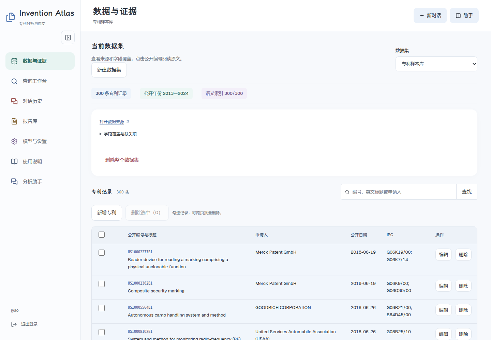

手机截图

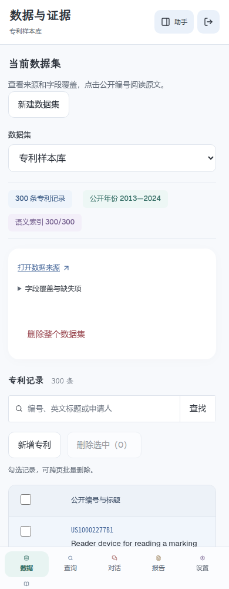

## 分析前的数据整理

导入后运行数据概况和质量审计。限定技术领域时，先建立检索候选集并检查标题摘要。补充资料需保留来源和获取日期，不以推测值提高字段覆盖率。

---

# 03 组织、项目与成员

组织管理账户和模型配置，项目划分研究资料与协作权限。数据集、原始材料、任务和报告均属于项目，切换项目后应重新核对研究对象。

自部署应用中的章节路由：`#guide/workspace`（登录后使用）。

## 建立研究项目

从管理菜单打开项目管理，选择已有项目；组织管理员可以创建项目并生成邀请。受邀者注册后加入组织，仍需分配项目成员权限。邀请由管理员自行转交，系统不发送邀请邮件。不同项目的资料不会因使用同一组织模型而合并。

## 成员角色和研究责任

项目负责人管理成员和角色，分析成员可以维护资料并执行任务，只读成员阅读授权资料与报告。组织管理员管理本组织成员及聊天模型，平台管理员管理账号启停和密码重置；平台管理身份不自动取得其他项目的研究资料。项目至少保留一名负责人。

## 协作前的范围核对

开始分析前确认当前项目、数据集和成员权限。已保存报告保留当次研究范围，切换项目或修改原始记录不会自动更新旧报告。账户停用、改密和成员移除影响后续访问，不能将访问失败解释为资料被删除。

---

# 04 研究材料与OCR

研究材料保存技术交底和待比较方案，为查新提供明确的输入文本及来源页码。材料提取与专利检索是不同操作，上传材料不会自动将其认定为公开现有技术。

自部署应用中的章节路由：`#guide/materials`（登录后使用）。

## 上传、版本和文本提取

从报告库进入项目材料，上传PDF、Word或文本材料，检查提取内容并保留原文件。修订文本形成新的材料版本，旧版本用于核对已创建任务的输入。文字型PDF可以提取文本；扫描页面需进行OCR。删除或移除材料与删除研究报告分别处理。

## 扫描页面识别

选定需识别的原文件页码后提交OCR，页面展示任务进度和逐页结果。服务器配置MinerU Cloud时，新任务使用vlm模型；未配置时使用本地Tesseract。MinerU按PDF分片上传并保存批次，已完成页和分片可供续跑。云端失败不会静默改用另一引擎。启用云服务会将选定PDF内容发送给该服务，敏感材料应先确认授权。

## 从材料创建查新输入

检查识别文字中的技术术语、表格和公式，再选择材料版本或已完成OCR的页码创建技术方案查新。页码对应原文件，不能将片段页序当作原始页号。OCR文字是识别结果，保留页码证明来源，不能证明识别正确；尚未完成的页不应当作完整输入。

---

# 05 技术交底整理

技术交底整理保存方案描述与修订版本，用于形成查新和布局研究的输入。交底内容由用户提供，模型追问用于发现需要补充的描述，不自动认定材料具有缺陷。

自部署应用中的章节路由：`#guide/disclosures`（登录后使用）。

## 方案保存与修订

在报告库打开技术交底材料，填写技术问题、方案措施及相关说明，保存当前版本。修订追加新版本，保留旧文本和相关任务的来源。原始PDF、Word和扫描页通过原始材料入口保存，整理后的交底与原文件分别核对。

## 材料追问与补充内容

选择已保存版本生成技术追问，模型依据该版本内容提出补充问题，并提供所指原文。回答后由用户决定是否修订交底，追问不会自动改写保存材料。检查术语、结构关系及必要条件，避免只补充目标效果而遗漏实现措施。

## 交底与专业任务衔接

将确认的方案文本用于技术方案查新，记录输入版本及所选原文页。后续对照保留方案特征引文与候选专利证据，两类来源分别标识。材料修订后若要研究新方案，应重新准备特征和下游产物，不能只修改报告标题。

---

# 06 数据概况

数据概况汇总语料规模、公开年份和字段覆盖率，用于判断后续方法是否具备输入条件。该功能说明研究范围，未执行数据真实性或全球覆盖程度的认证。

自部署应用中的章节路由：`#guide/get_dataset_summary`（登录后使用）。

## 字段覆盖率

覆盖率等于筛选范围内字段非空的记录数除以输入记录数。100%仅表示字段非空，不表示内容已获官方核验。同族标识与成员列表是不同信息；有引证字段也不表示具备完整前向引证。比例和百分数应区分，例如0.008对应0.8%。

## 查看数据概况

在数据与态势组选择数据概况，必要时限定公开年份、申请人或IPC，再确认计数口径并运行。核对记录数和索引数量，随后读取覆盖率表。范围改变后重新计算，不沿用全库比例。

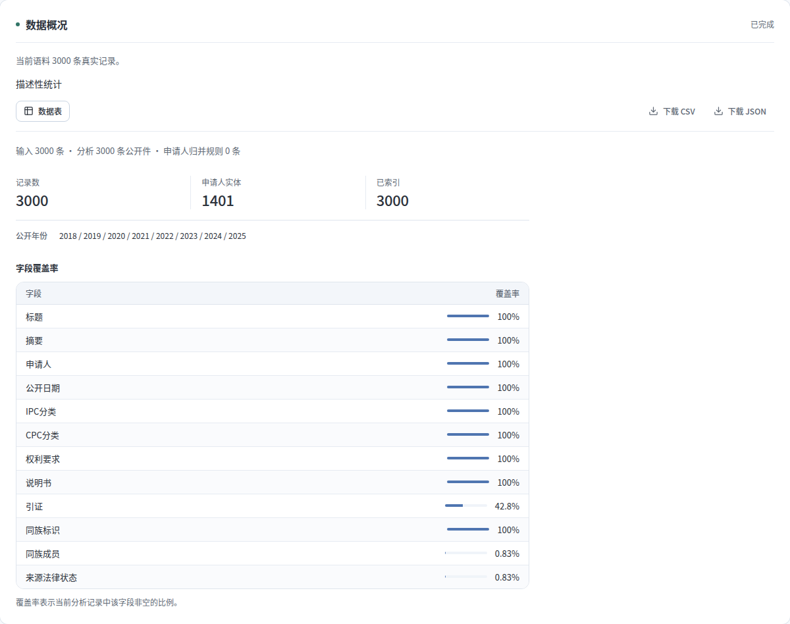

手机截图

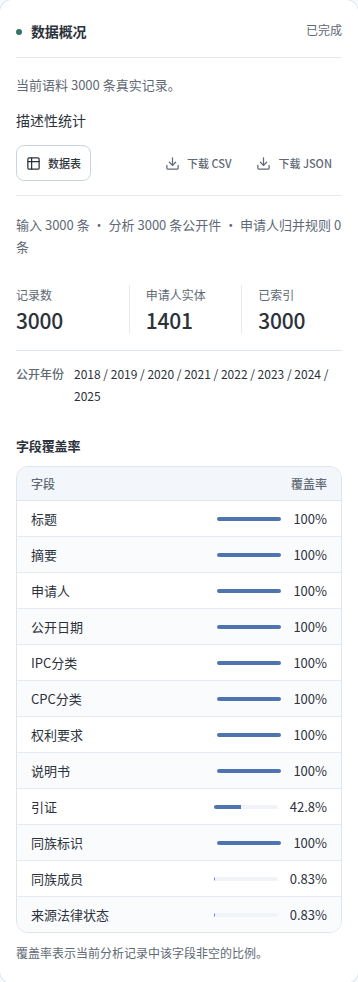

## 分析输入的判断

记录数是当前公开件或同族代表件数量，申请人数按已确认名称规则统计。年份栏列出有记录的公开年，空缺不能证明该年没有专利。文本分析依赖标题摘要或全文，引证网络依赖真实引用，同族和状态分析仅覆盖有来源资料的子集。报告应区分子集数量与研究语料总量。

### 示例请求

> 检查当前数据集的时间范围、字段覆盖率和缺失项，说明哪些分析可以开展。

在应用中点击“直接运行示例”，在查询工作台按演示参数运行该工具，结果显示在本页；点击“填入示例并打开功能”则只打开参数表单，确认后点击“运行分析”。如需功能解释，可单独点击“询问助手”。

---

# 07 数据质量审计

数据质量审计检查规范字段和原文定位，识别影响计算的导入或维护问题。审计结果提供具体公开编号及异常类型，便于修正后复验。

自部署应用中的章节路由：`#guide/audit_dataset`（登录后使用）。

## 检查项目与异常分类

程序检查字段缺失、公开日期格式和重复公开编号。对具有来源偏移的权利要求，核对截取原文与保存文本是否一致。引证、同族或法律状态缺失可能由来源造成，不能直接认定为导入错误或虚假记录。

## 运行和处理异常

选择数据集或筛选范围，在审计与监测组执行数据质量审计。按结果中的公开编号打开原文，区分资料缺失与解析错误，在记录编辑或重新导入环节修正，随后重新运行。

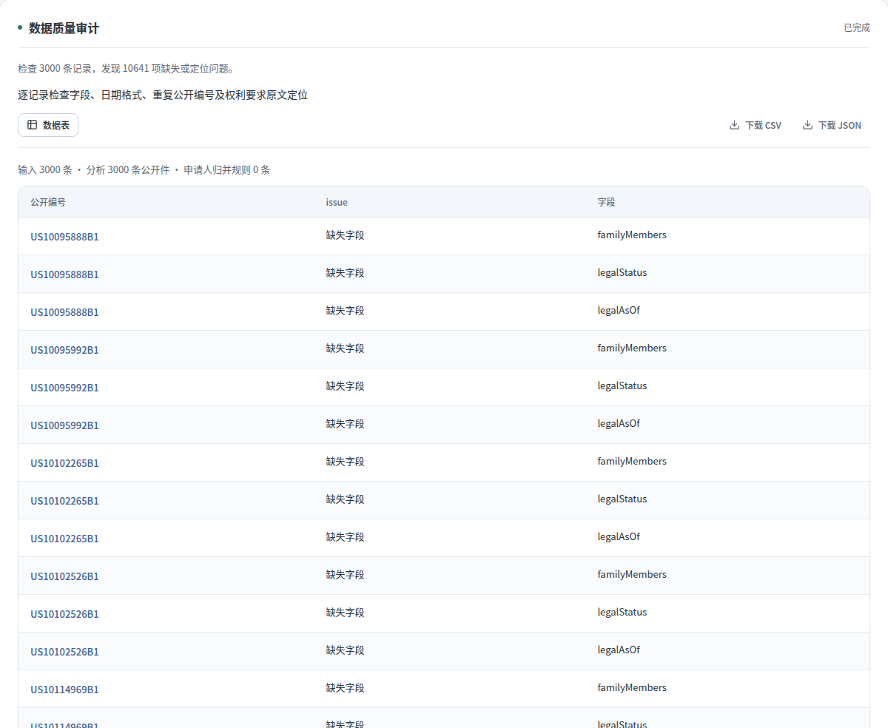

手机截图

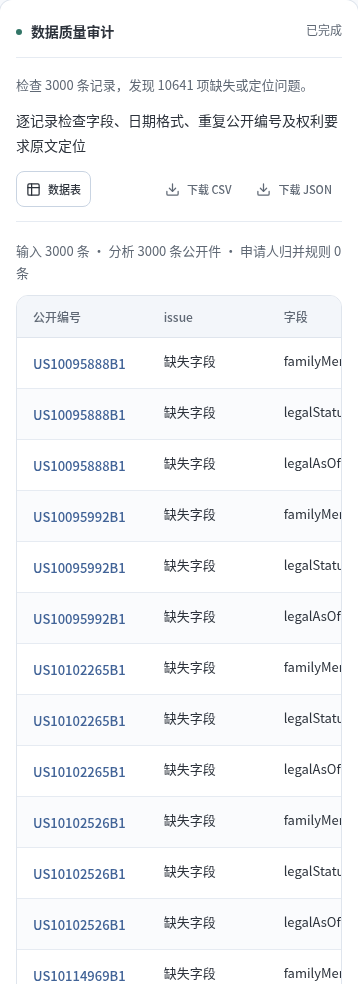

## 问题数与记录数

每行是一项问题。同一专利可能产生多项异常，异常行数不能当作异常专利数。定位不一致需要检查来源版本、文本编辑及解析偏移；缺失字段应查是否存在真实出处。审计仅检查结构与定位，未认证法律效力和文本解释正确性。

### 示例请求

> 审计当前数据集的字段缺失、日期格式、重复公开编号及权利要求原文定位，列出待复核项。

在应用中点击“直接运行示例”，在查询工作台按演示参数运行该工具，结果显示在本页；点击“填入示例并打开功能”则只打开参数表单，确认后点击“运行分析”。如需功能解释，可单独点击“询问助手”。

---

# 08 研究范围与计数口径

研究范围确定参与计算的文献集合，计数口径确定文献如何计入统计。跨工具比较需保持两者一致，避免将筛选变化解释为技术或主体结构变化。

自部署应用中的章节路由：`#guide/tools`（登录后使用）。

## 全库、候选集与上轮范围

当前数据集分析针对所选语料。限定用途的问题先检索，后续工具计算候选集；继续上轮研究时沿用上轮文献集合。Top-K限制返回候选数，不是全部命中数或行业专利总量。

## 公开件与同族代表件

公开件保留各公开编号。同族代表件按来源familyId归组，保留范围内最早公开件；缺标识的记录独立保留。代表件字段不能视为整个同族的共同属性，同族标识也不能替代完整成员列表。原文工具按公开版本读取。

## 计算参数和显示参数

公开年按公开日期筛选，申请人条件匹配名称，IPC条件匹配前缀。返回数量限制计算后保留的排名项目，显示滑块只改变已有结果的展示。聚类K改变分组，需要重算。年度关键词若有8个观测年、每年返回10词，则输出80行；范围内全部文献仍参与计算。

## 在工作台直接运行

在查询工作台按分组选择工具，填写范围和工具参数后点击“运行分析”。每次运行保存为一条“工具 · 工具名”记录，从对话历史重新打开时回到查询工作台，不进入助手。停留在查询工作台时刷新页面，会恢复最近一次工具运行；仍在运行的任务继续显示进度，可点击停止。切换数据集会清空工作台结果，已保存的记录不受影响。

---

# 09 专利检索

专利检索从入库文献中建立与技术问题相关的候选集合，为后续统计和文本挖掘确定研究范围。候选相关性需要结合标题摘要及具体技术内容判断。

自部署应用中的章节路由：`#guide/search_patents`（登录后使用）。

## 语义检索与词法匹配

专利检索将问题转为嵌入向量，计算与标题摘要向量的余弦相似度，支持中文问题检索英文文献。工作台和助手中的专利检索均使用语义方法；检索策略比较及数据变化监测使用BM25词法匹配，需明确英文术语。两种得分尺度不同，不可跨方法比较，也不能视为准确率。

## 配置检索条件

输入技术对象或用途，例如 digital identity authentication。限定公开年份、主体或IPC，设置返回数量后执行。语义检索需完整索引。阅读高排名文献，核对对象及技术措施；改写表达后，可通过策略比较检查候选差异。

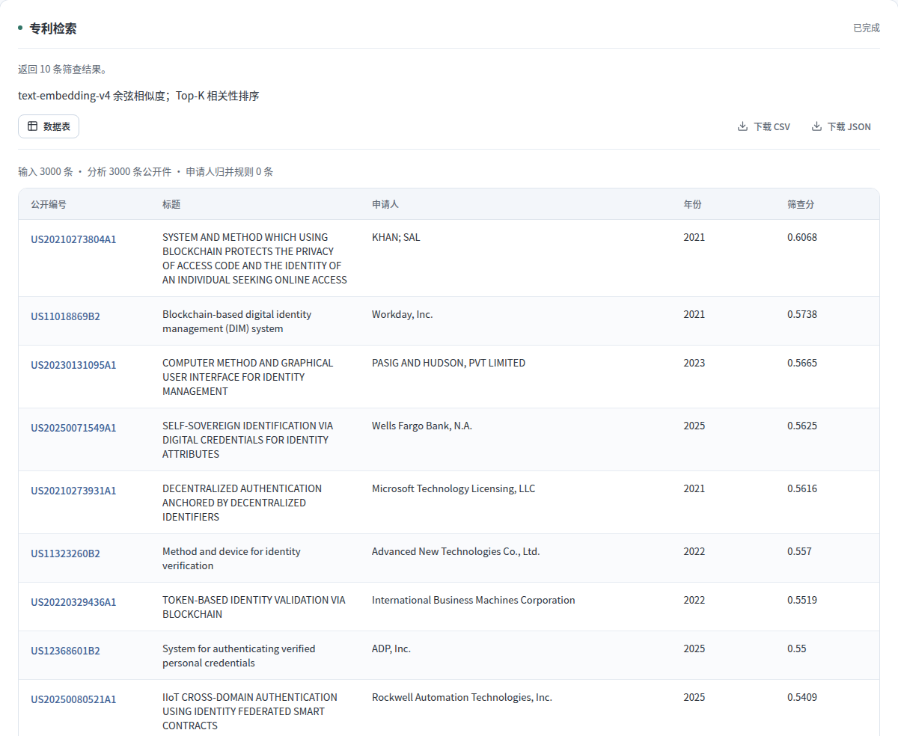

手机截图

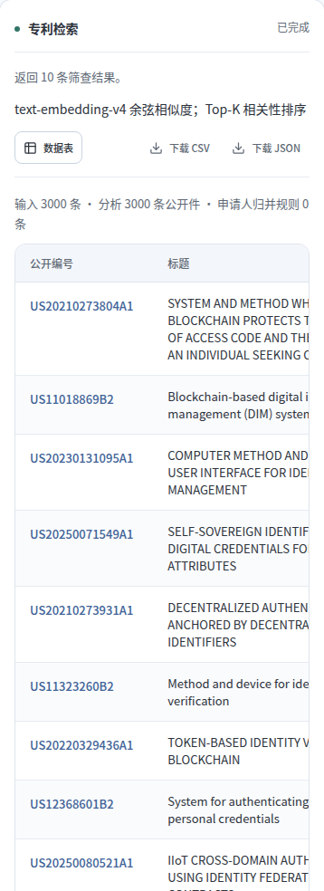

## 排序与后续分析

排名是当前问题和语料中的相对相关性。相同术语可能出现在无关领域，需核对摘要或原文。助手按候选集分析时保存该范围，报告说明候选数量与检索方法。增加Top-K不能证明查全，也不会触发全球在线搜索。

### 示例请求

> 检索当前数据集中与数字身份认证相关的专利，列出代表专利和相关依据。

在应用中点击“直接运行示例”，在查询工作台按演示参数运行该工具，结果显示在本页；点击“填入示例并打开功能”则只打开参数表单，确认后点击“运行分析”。如需功能解释，可单独点击“询问助手”。

---

# 10 全文片段检索

全文片段检索用于寻找说明书或权利要求中与技术问题相关的原文，为技术特征比较及报告论证提供可定位证据。检索对象是指定版本的已索引片段，返回内容保留公开编号和字段位置。

自部署应用中的章节路由：`#guide/search_patent_passages`（登录后使用）。

## 原文版本和索引条件

全文索引按保存的原文版本建立。摘要、说明书和各项权利要求分别切分，权利要求保留编号及从属关系；过长文本再拆分。段落向量与标题摘要向量分开存储，声明模型和维度。原文修订需建立新版本，旧版本仍用于核对历史引文。向量任务失败后可续跑已保存批次，无须重算完成的片段。

## 检索与原文定位

在数据与证据页面的全文证据检索区域选择原文版本，输入技术措施或具体问题，执行检索。点击命中条目的定位原文，窗口显示保存时的原文并高亮对应片段。分析助手及工具目录也可调用全文片段检索，query填写问题，index_version可明确指定版本；未指定时选择版本列表中的末项。限定编号与年份后，仅在该范围内召回。

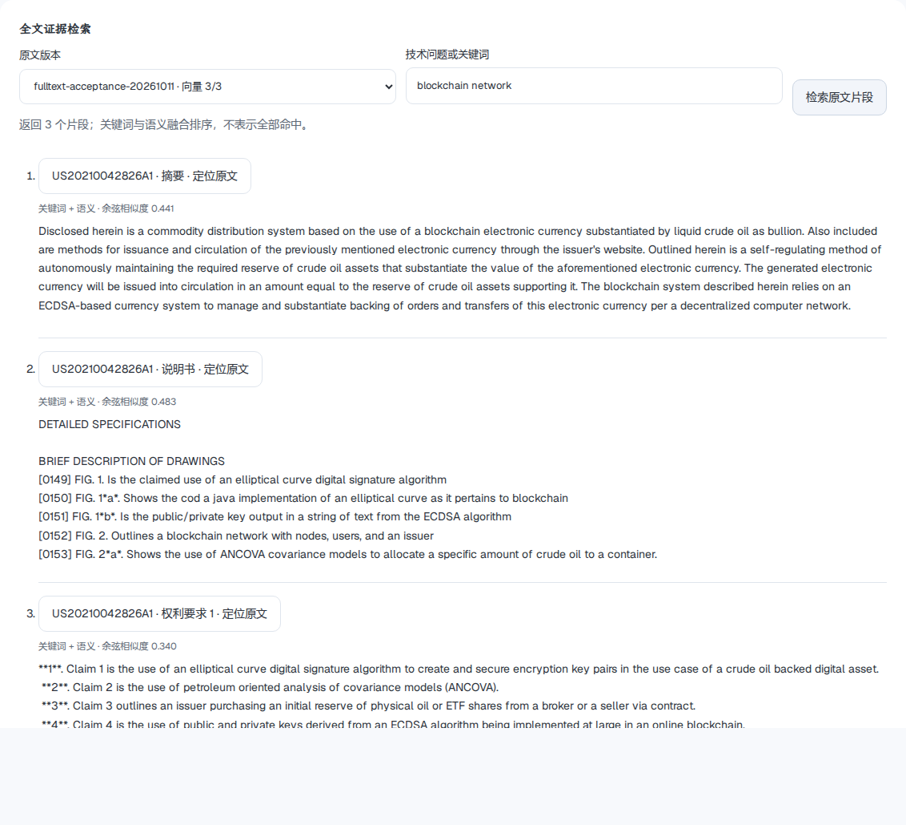

手机截图

## 命中排序与证据解释

关键词召回使用空格分隔术语的字面匹配，支持中文字符串；语义召回计算同一模型空间内的余弦相似度，两路候选按倒数排名融合。融合分数和余弦相似度是排序依据，均不是相关性准确率。向量未建立时仅返回关键词结果；部分向量完成时语义召回覆盖范围较小。Top-K是返回片段数，同一专利可有多个片段，不能据此计算专利数量或查全率。原文定位确认引文出处，技术解释仍需结合上下文判断。

## 记录索引与全文索引

标题摘要索引用于召回专利记录；全文片段索引用于定位权利要求和说明书中的证据。两者的覆盖数量分别检查，记录索引完成不表示全文已分段并嵌入。建立全文索引时确认原文版本及覆盖编号，完成后以具体技术措施检索，并打开原文验证片段位置。

### 示例请求

> 在已建立的全文索引内检索数字身份认证相关片段，列出原文版本、专利编号和逐字证据。

在应用中点击“直接运行示例”，在查询工作台按演示参数运行该工具，结果显示在本页；点击“填入示例并打开功能”则只打开参数表单，确认后点击“运行分析”。如需功能解释，可单独点击“询问助手”。

---

# 11 检索策略比较

检索策略比较评估不同术语组合对返回集合的影响，用于记录检索方案及识别遗漏或歧义。程序比较候选重合和差异，未计算未经标注的查全率。

自部署应用中的章节路由：`#guide/audit_search_strategy`（登录后使用）。

## 集合比较方法

各策略使用相同BM25方法和Top-K上限。独有命中指仅存在于该策略的返回记录；新增与移除相对于上一策略计算，不表示专利新公开或失效。无完整相关文献标注时，返回数量不能当作检索质量指标。

## 设置多版检索表达

填写至少两组策略名称与表达，例如 blockchain 和 blockchain identity authentication。保持年份、主体及返回数量一致，运行后查看独有编号和交集差异。打开独有文献，检查补充词是否引入相关用途或造成无关匹配。

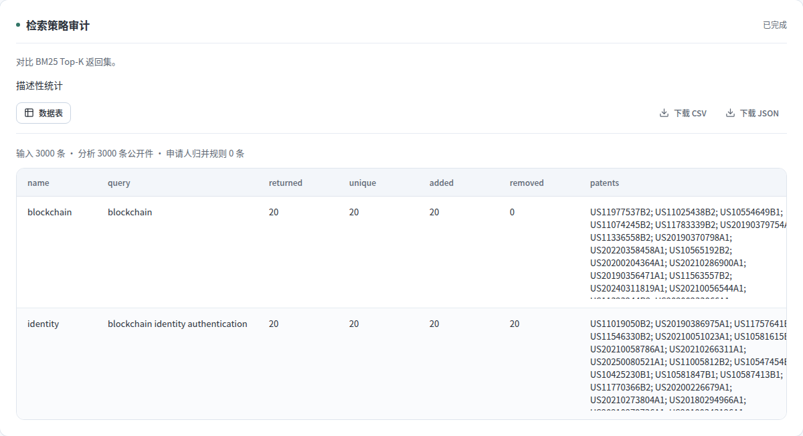

手机截图

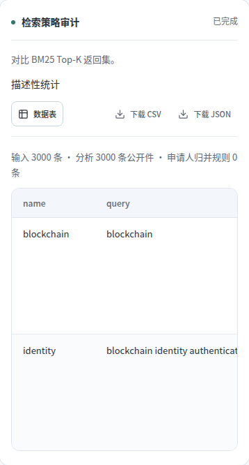

## 检索差异的解释

独有记录可能来自术语作用，也可能来自排序边界。高度重合只说明当前语料和Top-K下的返回集接近，不能证明两种表达在全球数据中等价。将策略、参数及候选编号与后续研究范围一同保存，便于解释结果变化。

### 示例请求

> 比较blockchain与blockchain identity authentication两种检索策略，展示重合与独有命中。

在应用中点击“直接运行示例”，在查询工作台按演示参数运行该工具，结果显示在本页；点击“填入示例并打开功能”则只打开参数表单，确认后点击“运行分析”。如需功能解释，可单独点击“询问助手”。

---

# 12 专利原文与详情

专利详情用于核对统计和主题分析涉及的具体文献。公开版本的权利要求与说明书提供技术判断依据，来源链接用于回查公开记录。

自部署应用中的章节路由：`#guide/read_patent_details`（登录后使用）。

## 公开版本和主体角色

保留公开编号中的A1、B1或B2等种类代码。申请公开与授权权利要求可能不同，分析前需确认版本。申请人、受让人和发明人分别表示不同角色；公开日不能替代申请日或最早优先权日。

## 读取指定文献

从检索结果、代表文献或图谱点击公开编号，或输入1—5个当前范围内编号。阅读摘要确定技术对象，再查独立权利要求及实施方式。未命中编号不会替换为其他记录，缺失字段不会补造。

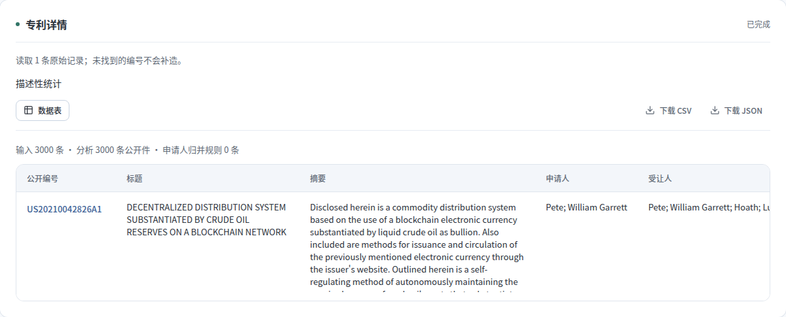

手机截图

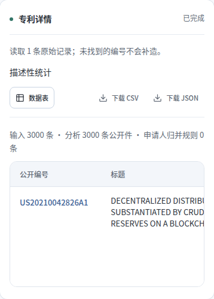

## 原文证据的使用

摘要概括技术内容，权利要求记载请求保护的方案，说明书提供背景与实施细节。技术效果需引用实际声明所在段落，不能只凭标题推断。系统保存的是已获取版本，不保证包括后续修改或最新法律状态。

### 示例请求

> 选择当前数据集中的一项专利，展示摘要、申请人、权利要求和原文来源。

在应用中点击“直接运行示例”，在查询工作台按演示参数运行该工具，结果显示在本页；点击“填入示例并打开功能”则只打开参数表单，确认后点击“运行分析”。如需功能解释，可单独点击“询问助手”。

---

# 13 技术问题、手段与效果

原文阅读按技术问题、解决手段和声明效果整理指定专利，为技术方案比较提供带有出处的阅读笔记。笔记区分原文引文与模型解释，保留公开版本及字段位置。该功能用于文献阅读准备，不认定技术方案完整性或法律效力。

自部署应用中的章节路由：`#guide/analyze_patent_reading`（登录后使用）。

## 指定文献与处理范围

在专利详情中点击分析技术问题、手段与效果，或在查询工作台填写当前范围内的公开编号。一次可指定1—5件，未指定或编号不属于当前范围时拒绝执行。程序分别读取已保存的摘要、各项权利要求和说明书分段，按段整理笔记。已完成分段可在原文未变时复用；未保存的内容不属于本次阅读范围。

## 阅读笔记和引文定位

结果按技术问题、解决手段和声明效果分组，每项同时显示模型解释与逐字引文。点击查看专利原文，打开保存字段并高亮引文。导入时合并保存的权利要求可拆分阅读，定位仍使用原保存条目的偏移，阅读编号与保存编号应分别核对。下载结果可保留分组、引文及位置，报告引用沿用同一来源关联。

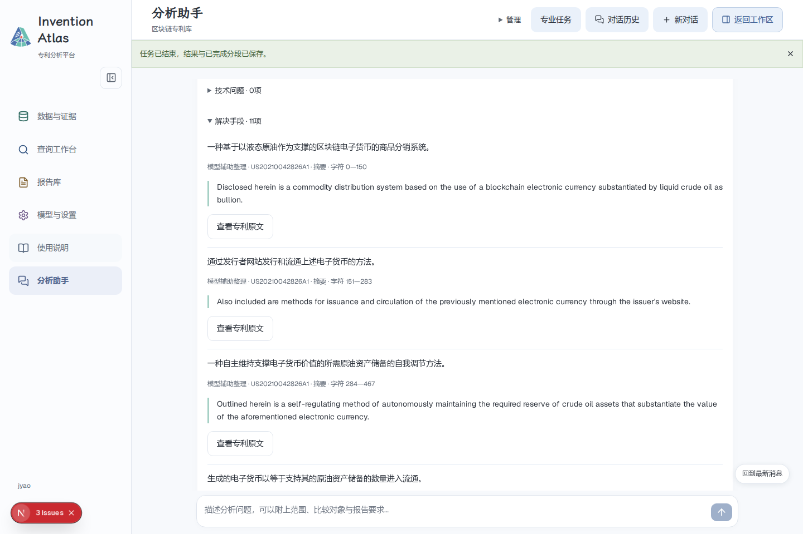

手机截图

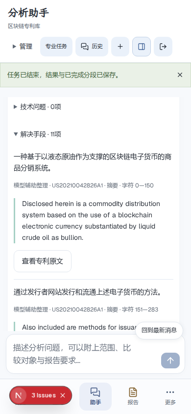

## 抽取结果的解释

同一字段可产生多项笔记，笔记数不等于专利数或独立技术特征数。没有结果的分组表示本次未提取到明确依据，不能据此断言专利没有相应内容。效果仅代表原文声明，未获独立实验验证。引文定位核对出处，不证明模型解释正确；技术背景、术语用途或兑换比例不能用常识补充。逐段处理也不能证明全部技术要素均已识别。

### 示例请求

> 选取当前数据集中的一项原文完整且篇幅适中的专利，分别整理技术问题、技术手段和原文声明的效果，逐项提供引文及字段位置；没有明确依据的内容不作推断。

在应用中点击“直接运行示例”，在查询工作台按演示参数运行该工具，结果显示在本页；点击“填入示例并打开功能”则只打开参数表单，确认后点击“运行分析”。如需功能解释，可单独点击“询问助手”。

---

# 14 检索方法对比

检索方法对比采用专利查专利的查询方式，比较BM25、已存向量余弦与RRF融合。查询向量来自查询专利本身，工具不生成嵌入，不调用模型或外部API。

自部署应用中的章节路由：`#guide/compare_retrieval_methods`（登录后使用）。

## 固定查询与候选排名

按固定种子从当前范围的授权件抽样，默认50件，查询文本取标题和摘要，所有方法排除本件。BM25的k1默认1.2、b默认0.75；RRF按两路排名倒数相加，常数默认60。查询专利数、随机种子、BM25参数和RRF常数都可在工具表单中修改。

## 两套伪相关指标

互引强相关池由语料内引用查询或被查询引用的记录组成；IPC弱相关池为任一IPC主组相同的记录，两者独立按二元相关评估。在k=5、10报告P、Recall及nDCG，并给出有正例查询数、平均查询时间和引用覆盖率。没有正例的查询不进入指标平均，全部无正例返回null。

## 缺失资料与结果解释

伪标注，非人工评判；引用覆盖率不足时查全率被低估。缺少引用时保留IPC指标；缺少可用嵌入时保留BM25，向量与RRF跳过相关查询并警告。各方法保存实际查询编号，覆盖不一致时不能把指标差异直接归因于算法。排名和相关池编号可用于逐条原文复核。

### 示例请求

> 从当前数据集按固定种子抽样授权专利，比较BM25、已存嵌入余弦和RRF的检索指标及耗时，说明互引与IPC伪标注限制。

在应用中点击“直接运行示例”，在查询工作台按演示参数运行该工具，结果显示在本页；点击“填入示例并打开功能”则只打开参数表单，确认后点击“运行分析”。如需功能解释，可单独点击“询问助手”。

---

# 15 自动分类方法对比

自动分类方法对比以第一个IPC主组为标签，比较嵌入kNN、最近质心及BM25文本近邻投票。程序只使用已存数据和开发集统计，不训练模型，不调用模型或嵌入API。

自部署应用中的章节路由：`#guide/compare_classification_methods`（登录后使用）。

## 类别与开发集划分

默认只保留至少10件的类别，以固定种子42分层按7:3目标比例划分开发与留出，每类至少2件开发、1件留出。开发集内默认3折交叉验证，在近邻数[1,3,5,7]中按宏F1选参，同分选择较小值。每折只从其训练部分计算邻居、IDF与质心。

## 一次留出评估

选参函数只接收开发集，所有方法选参完成后才检查留出向量和进行一次留出预测。输出准确率、宏F1、Top-3准确率，分别保存选参与评估耗时、实际开发/留出编号和各折验证编号。每条预测提供开发集近邻编号及余弦或BM25分数。每类最少件数、开发集比例、折数、随机种子和近邻数候选可在工具表单中修改。

## 适用范围与后续复核

缺嵌入时仍执行BM25投票，嵌入方法不足以覆盖各类开发样本时跳过并警告；无正分文本近邻时弃答，按错误计入指标。随机划分可能包含跨集同族或重复文本，结果不能直接代表跨时间或新同族泛化。参数候选应在看留出结果之前确定，不反复挑选最好留出结果。

### 示例请求

> 以第一个IPC主组为标签，比较kNN、最近质心与BM25投票；只在开发集选参，报告一次留出集指标、耗时和近邻证据。

在应用中点击“直接运行示例”，在查询工作台按演示参数运行该工具，结果显示在本页；点击“填入示例并打开功能”则只打开参数表单，确认后点击“运行分析”。如需功能解释，可单独点击“询问助手”。

---

# 16 公开趋势分析

公开趋势分析按公开日期汇总专利数量，用于描述研究语料的时间分布和公开活动变化。年度或月度序列可辅助确定比较区间，并与主体布局及技术主题联合分析。

自部署应用中的章节路由：`#guide/analyze_patent_trend`（登录后使用）。

## 日期字段与统计口径

程序读取公开日期，按年或月汇总筛选记录。公开日与申请日存在时差，公开量不能直接表示同期研发投入。公开件统计保留不同编号，同族代表件按来源标识去重，两者规模含义不同。

## 执行公开趋势分析

选择公开趋势，设置年或月频率及起止公开年份，必要时限定主体或IPC。运行后切换图表和数据表，核对时间点数量及总和。改变口径后重新计算，不仅更改图例。

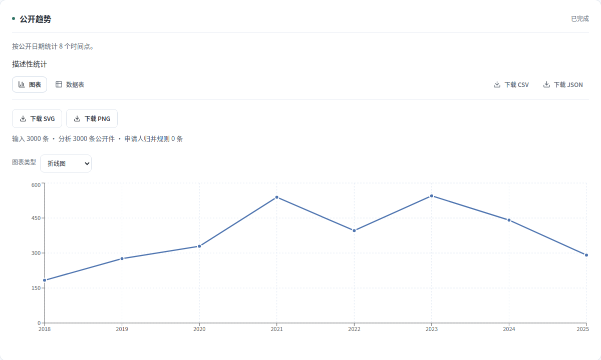

手机截图

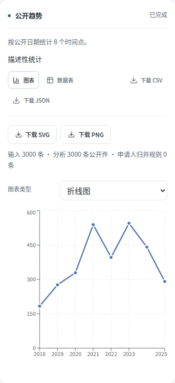

## 趋势图与观测窗口

横轴为公开时间，纵轴为当前口径的记录数。判断变化前检查首末年份是否完整、月份是否缺失，以及导入范围是否一致。定向样本只能支持样本分布描述，曲线下降不能单独证明技术衰退；近期减少还可能来自公开滞后。对峰值可按申请人分解并阅读该区间文献，核对集中公开及主题变化。

### 示例请求

> 统计这批专利的年度公开趋势，展示图表，并说明抽样和缺失年份的影响。

在应用中点击“直接运行示例”，在查询工作台按演示参数运行该工具，结果显示在本页；点击“填入示例并打开功能”则只打开参数表单，确认后点击“运行分析”。如需功能解释，可单独点击“询问助手”。

---

# 17 生命周期统计

生命周期统计以累计公开量的增长形态描述语料的时间演变，并检验其与Logistic曲线的拟合关系。该方法可补充时间结构研究，样本曲线不能直接确立行业的技术生命周期阶段。

自部署应用中的章节路由：`#guide/analyze_lifecycle`（登录后使用）。

## 累计公开量与Logistic模型

先按公开年计算数量及累计量C(t)。至少有6个观测公开年时，拟合 F(t)=L/[1+exp(−k(t−t₀))]，L为渐近上限，k为增长参数，t₀为拐点年份。实现采用非线性最小二乘和150轮坐标优化，未执行未来公开量预测。

不足6年时保留年度与累计统计，不强行拟合。缺失年份不会补造专利记录。

## 运行生命周期统计

选择足够时间跨度，保持与公开趋势相同的年份和计数口径，再运行生命周期统计。查看累计观测曲线与拟合曲线，随后切换数据表读取参数、残差和拟合诊断。界面未开放其他增长模型或预测时段。

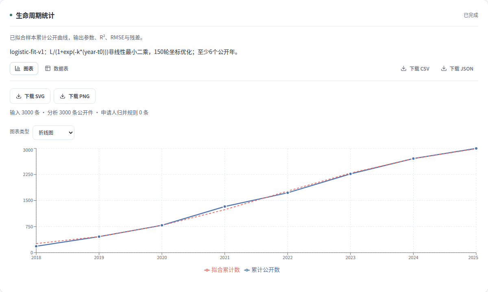

手机截图

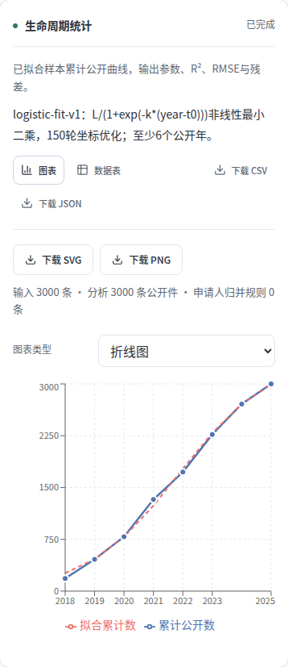

## 拟合诊断与参数识别

R²描述对观测累计量变异的拟合程度，RMSE以记录数为单位表示残差规模，残差为观测值减去拟合值。拟合诊断不验证技术成熟度，也不代表预测准确率。

拐点超出观测窗口或渐近上限接近搜索边界时，参数识别不足。即使R²较高，也需检查观测窗口、累计序列及取样方式，不能将抽样形成的S形结构认定为行业增长规律。

### 示例请求

> 对这批专利进行生命周期统计，展示观测值、拟合曲线和拟合限制。

在应用中点击“直接运行示例”，在查询工作台按演示参数运行该工具，结果显示在本页；点击“填入示例并打开功能”则只打开参数表单，确认后点击“运行分析”。如需功能解释，可单独点击“询问助手”。

---

# 18 IPC分类分布

IPC分类分布描述语料涉及的技术类别，用于识别主要领域和交叉分类。它使用文献的国际专利分类标引，不能替代语义主题或全文判断。

自部署应用中的章节路由：`#guide/analyze_ipc_distribution`（登录后使用）。

## 分类粒度与重复计数

当前实现统计IPC前4位的小类代码。同一专利同一小类只计一次，涉及多个小类则分别计入，分类次数合计可超过专利数量。CPC单独保存，不混入IPC；缺少分类不由模型补充。

## 设置范围和数量

限定公开年与申请人条件，IPC前缀可限制较大技术范围。返回数量控制保留的小类排名。运行后查看代码及数量，对单一主体重复执行可比较其与全库的分类构成。

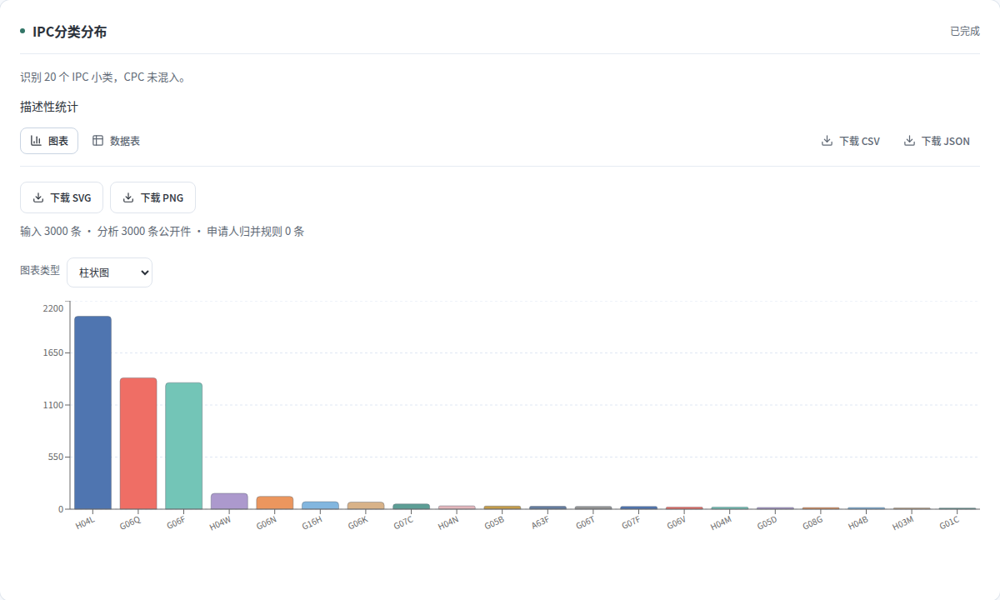

手机截图

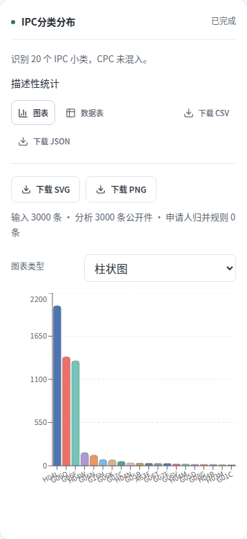

## 分类构成的解释

高频IPC表示当前语料中该类别出现较多，不直接表示市场份额或研发投入。小类统计合并多个主组和子组，具体方案差异仍需读文献。多分类专利应检查交叉技术组合，不能强行归入单一互斥领域。

### 示例请求

> 分析这批专利的IPC分类分布，找出主要技术分类并展示图表。

在应用中点击“直接运行示例”，在查询工作台按演示参数运行该工具，结果显示在本页；点击“填入示例并打开功能”则只打开参数表单，确认后点击“运行分析”。如需功能解释，可单独点击“询问助手”。

---

# 19 公开局分布

公开局分布依据编号前缀描述语料的公开机构构成，用于检查记录来源及地域覆盖。公开局不表示主体国籍或当前有效权利地域。

自部署应用中的章节路由：`#guide/analyze_country_distribution`（登录后使用）。

## 编号前缀和来源

程序读取US、EP或WO等公开局代码并汇总。单一公开局占比高可能首先反映来源构成。缺少最早同族公开时点，系统不能判定首次公开局。

## 查看公开局统计

在数据与态势组选择记录公开局，保持与其他图表相同的年份及口径，查看代码与数量。需要研究跨地域同族申请时，转至同族地域并确认成员覆盖，不能由公开局分布替代。

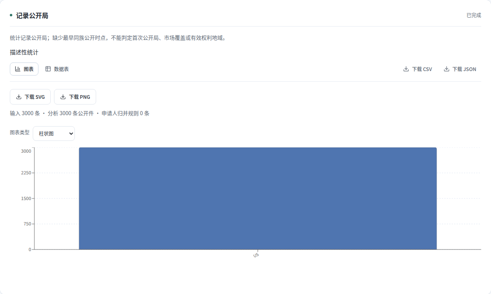

手机截图

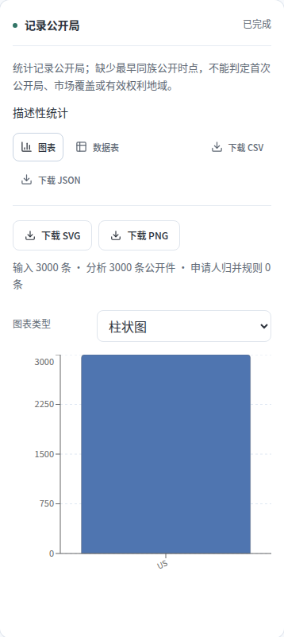

## 地域分析的条件

统计可用于来源审计及样本公开覆盖描述，未测量总部地域、销售市场或有效权利范围。WO国际公布不表示所有国家均有有效专利。单一公开局语料只返回一类是有效结果，不人为增加地域类别。

### 示例请求

> 统计这批专利的公开局分布，注意不要将公开局解释为申请人国籍。

在应用中点击“直接运行示例”，在查询工作台按演示参数运行该工具，结果显示在本页；点击“填入示例并打开功能”则只打开参数表单，确认后点击“运行分析”。如需功能解释，可单独点击“询问助手”。

---

# 20 关键词词频分析

关键词分析提取标题摘要词项，用于识别反复出现的技术对象及表达。TF、DF和TF-IDF分别描述重复程度、文献覆盖及区分度，三者需分别解释。

自部署应用中的章节路由：`#guide/generate_wordcloud`（登录后使用）。

## 分词与权重计算

程序对英文标题摘要提取词项并去除停用词。TF为出现总次数，DF为含词文档数。权重采用 (1+ln TF)×[1+ln((N+1)/(DF+1))]，N为参照语料文档数。少量文献密集重复可产生高权重，不能直接等同于广泛热点。

## 词云与指标选择

设置返回词项数及研究范围，运行后切换词云、图表和数据表，可选择TF-IDF、TF或DF作为指标。显示数量滑块只控制已有项目的可视化。点击词云词项可持续查看指标信息。

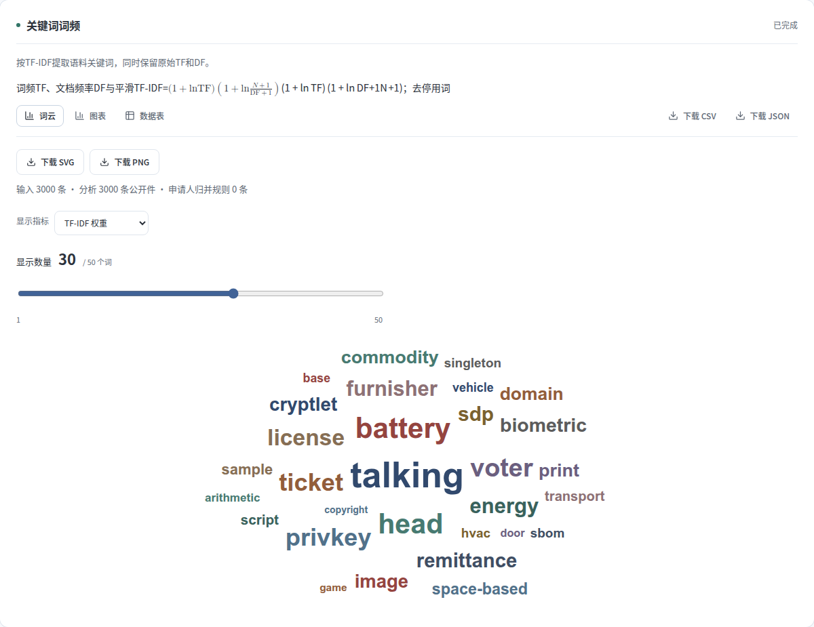

手机截图

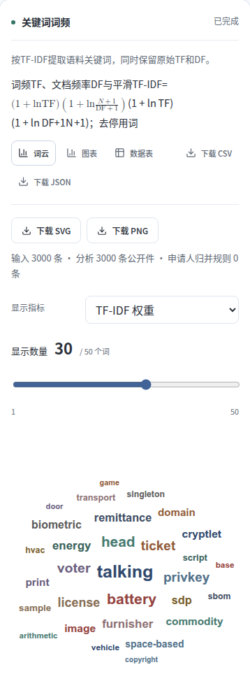

## 词项的语境核对

字号对应所选指标，颜色用于区分词项。缩写和一般词汇应结合具体文献判断。比较TF与DF可区分少量长文本重复与较多文献的共同关注。分词主要针对英文，词云不是官方分类，也不能替代主题归纳。

### 示例请求

> 统计这批专利的主要技术关键词，展示词频和代表专利。

在应用中点击“直接运行示例”，在查询工作台按演示参数运行该工具，结果显示在本页；点击“填入示例并打开功能”则只打开参数表单，确认后点击“运行分析”。如需功能解释，可单独点击“询问助手”。

---

# 21 年度关键词分析

年度关键词按公开年计算词项权重，用于比较技术表述与关注对象的时间变化。各年度使用整个筛选语料作为逆文档频率参照，形成共同计算基准。

自部署应用中的章节路由：`#guide/analyze_yearly_keywords`（登录后使用）。

## 年度统计与返回行数

范围内全部记录按年分组，每组计算TF和DF，再以整体语料计算TF-IDF。返回数量是每年保留的词数。8年每年10词输出80行，全部输入记录仍参与计算。更改时间或技术范围也会改变参照语料，不应跨不同范围直接比较权重。

## 设置跨期比较

设置公开年份及每年词项数量，保持主体、IPC和口径一致。结果表区分年份和词项，图表显示权重。需要扩大观察时提高返回数量，不仅根据每年前几位词推断整个语料变化。

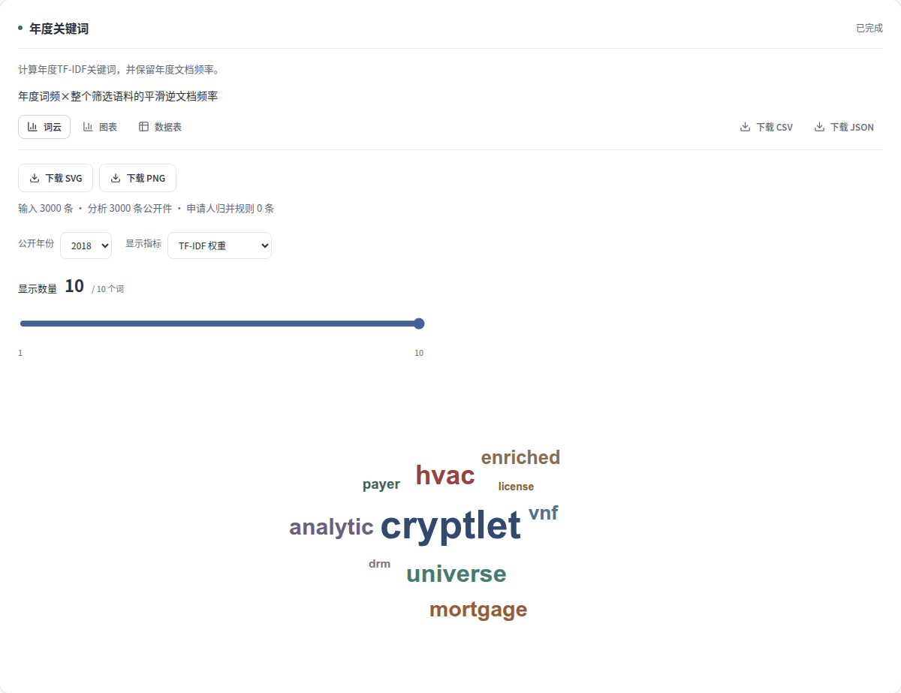

手机截图

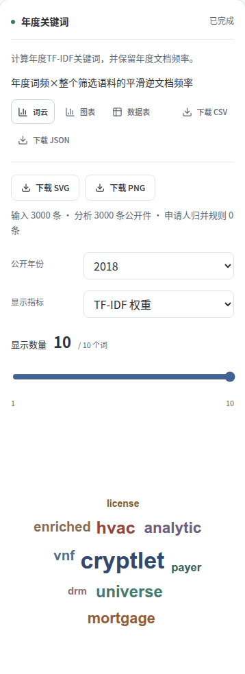

## 年度变化与文本依据

先核对词项的年度DF及对应文本，再分析权重变化。独有词可能来自少量特殊文献、缩写或命名差异。词项变化不证明技术首次出现和继承关系。持续关注区间可补充突现分析，语义相近而用词不同的文献可补充聚类；结果应与公开量共同解释。

### 示例请求

> 比较这批专利各年份的主要关键词，说明技术关注点的变化。

在应用中点击“直接运行示例”，在查询工作台按演示参数运行该工具，结果显示在本页；点击“填入示例并打开功能”则只打开参数表单，确认后点击“运行分析”。如需功能解释，可单独点击“询问助手”。

---

# 22 关键词突现分析

关键词突现识别词项相对于自身基线进入较高出现率状态的时间区间，用于定位样本中的阶段性关注变化。其结果补充年度词频，未以简单增幅替代模型。

自部署应用中的章节路由：`#guide/analyze_burst_terms`（登录后使用）。

## 状态模型和批次

实现采用Kleinberg批次到达模型、二项发射概率及Viterbi状态路径。s=2控制出现率倍数，gamma=1控制上升状态惩罚，界面未开放两者。至少需要两个公开年，仅对有记录的年份建立批次，不填造缺失年文献。

## 识别突现区间

选择时间跨度较长的语料，设置返回区间数后运行。核对词项、起止年及层级，再读取区间内含词文献。零区间表示模型未识别到符合条件的突现，也属于正常结果。

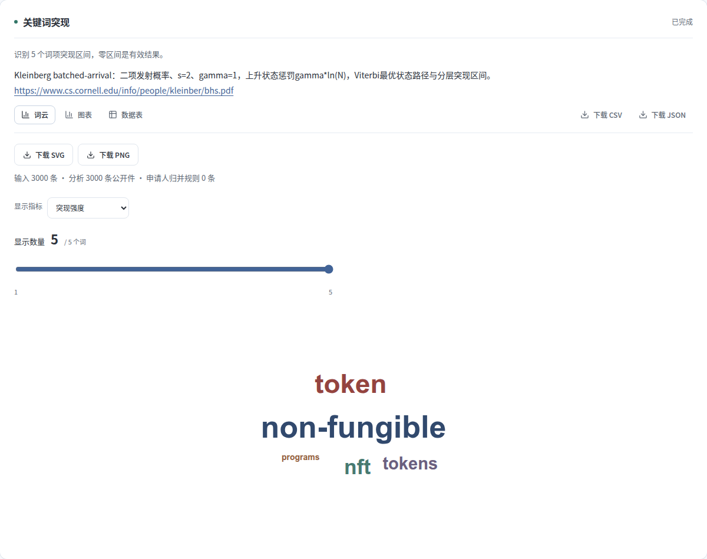

手机截图

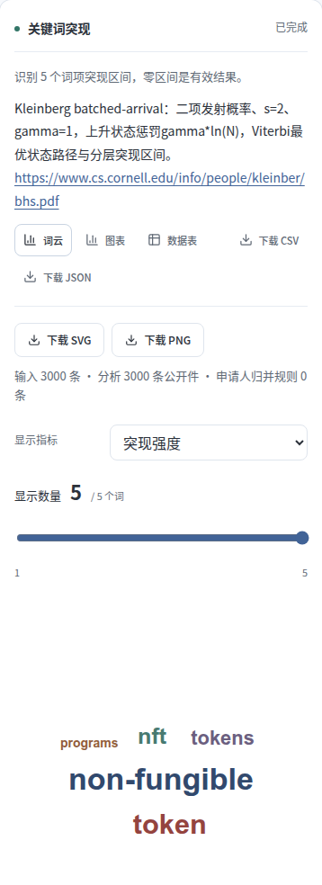

## 强度和层级

强度为所选状态相对较低状态的累计代价改善量，只宜在同一模型与语料下比较。层级是出现率状态等级，不是技术质量等级。文档数为区间各批次含词数之和。抽样和集中公开可能造成突现，不能直接解释为市场热度或技术突破。

### 示例请求

> 识别这批专利的关键词突现区间，说明计算方法和样本限制。

在应用中点击“直接运行示例”，在查询工作台按演示参数运行该工具，结果显示在本页；点击“填入示例并打开功能”则只打开参数表单，确认后点击“运行分析”。如需功能解释，可单独点击“询问助手”。

---

# 23 技术主题聚类

技术主题聚类依据标题摘要语义向量形成文献簇，用于组织技术主题和选择代表专利。分组是数据驱动的分析单元，不等同于IPC或固定边界的技术领域。

自部署应用中的章节路由：`#guide/charts`（登录后使用）。

## 高维分组与主题命名

在1024维嵌入空间使用余弦距离K-means，固定种子42，最多30轮。K在2—12之间选择，实际非空簇可少于K。每簇提取关键词及较接近中心的代表文献，模型据此生成中文名称；命名失败仍保留分组。

## 选择K并查看结果

确认索引完整，设定K及研究范围。可先用K=6，再在相同范围比较K=4或K=8。切换散点图、数量图及数据表，点击主题筛选，点击点位打开原文。K变化会改变分组，不能仅按编号对应两次结果。

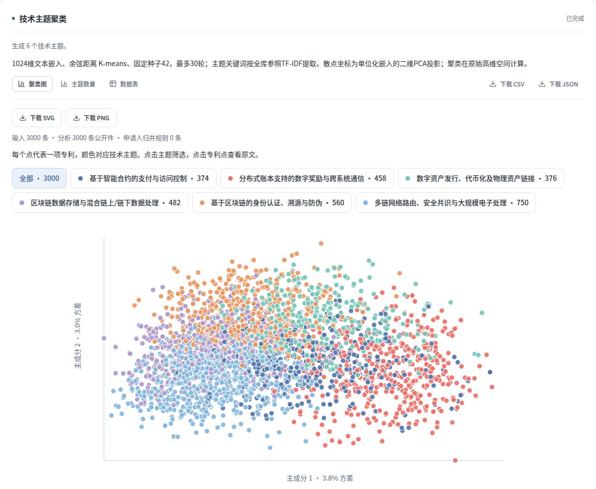

手机截图

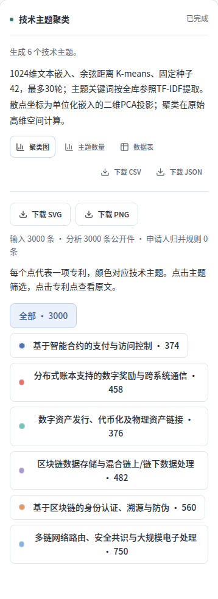

## PCA投影与主题解释

散点坐标为单位化嵌入的二维PCA投影，每点表示一项专利，颜色对应高维簇。轴上解释方差表示投影保留的变化比例，二维距离不能替代完整语义距离。主题名称是辅助概括，应核对关键词及代表文献。代表文献不能覆盖所有簇内差异，也不支持直接的新颖性判断。

### 示例请求

> 对这批专利进行K-means技术主题聚类，展示聚类散点图、主题关键词和代表专利。

在应用中点击“直接运行示例”，在查询工作台按演示参数运行该工具，结果显示在本页；点击“填入示例并打开功能”则只打开参数表单，确认后点击“运行分析”。如需功能解释，可单独点击“询问助手”。

---

# 24 关键词方法对比

关键词方法对比在同一语料中运行TF-IDF、TextRank和YAKE单词版，比较排序、一致性、示例专利和耗时。工具只做确定性程序计算，不调用模型或嵌入API。

自部署应用中的章节路由：`#guide/compare_keyword_methods`（登录后使用）。

## 三种关键词排序

TF-IDF复用现有语料词频和逆文档频率；TextRank在单篇专利内部按4词窗口统计共现，并合并计算加权PageRank；YAKE逐专利计算大小写、位置、词频、关联及句分布五特征，再聚合到语料。三者复用英文分词与停用词，不提取多词短语。

## 范围、参数与运行

从热点与主题组选择关键词方法对比，核对年份、申请人和IPC范围。工具表单中的“每种方法关键词数量”默认20，每种方法最多返回该数量的词。工具固定按公开件工作，结果沿用现有保存和分页机制。

## 排名重合与原文核对

关键词行提供方法、排名、分数、含词文献数及最多3件示例；另列三个两两Jaccard，即交集除以并集。分数尺度不同，不用绝对得分比较方法好坏；重合度也不是准确率。计算行记录参数、范围、种子、样本量与毫秒耗时，小样本单次时间不作吞吐结论。

### 示例请求

> 在当前数据集中比较TF-IDF、TextRank与YAKE的关键词排名、重合度、示例专利和耗时，不调用模型或嵌入接口。

在应用中点击“直接运行示例”，在查询工作台按演示参数运行该工具，结果显示在本页；点击“填入示例并打开功能”则只打开参数表单，确认后点击“运行分析”。如需功能解释，可单独点击“询问助手”。

---

# 25 申请人专利组合

申请人组合汇总主体公开数量与主要IPC，用于比较样本技术布局。主体与文献分布相结合，为跨期研究和代表专利选择提供基础。

自部署应用中的章节路由：`#guide/analyze_entity_portfolio`（登录后使用）。

## 主体识别与计数

统计读取申请人，与受让人角色分开。已确认别名可规范化，不自动识别母子集团。多申请人专利分别进入各主体组合，主体数量合计可超过专利数。

## 比较主体技术组合

设置主要主体数量，保持年份、技术范围及口径一致。查看数量排名与各主体前三个高频IPC。需要详细比较时以申请人条件运行IPC分布，再读取对应专利。

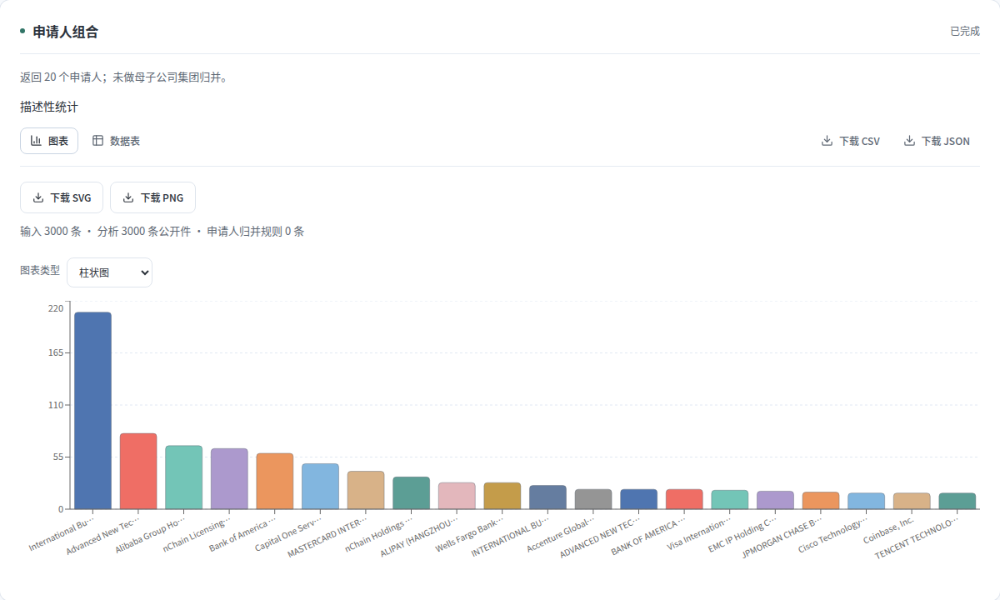

手机截图

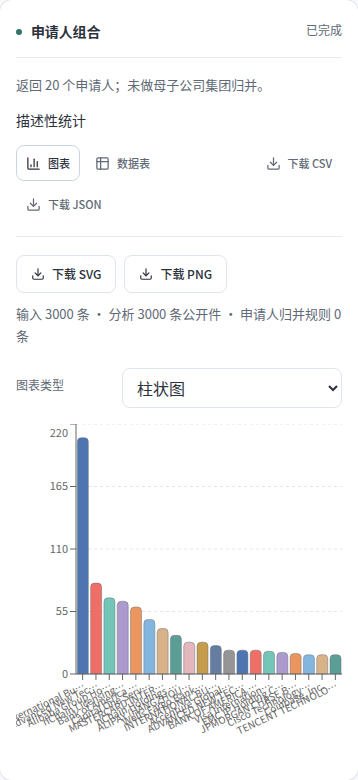

## 组合规模与分类侧重

数量仅表示样本中的相关记录，不等于完整资产规模。前三IPC仅概括高频类别，不能覆盖全部技术。名称可能属于公司、机构或自然人，不应仅凭名称自动判定类别。差异需结合来源覆盖、名称规则和文献内容判断。

### 示例请求

> 比较主要申请人的专利组合，列出数量、技术分类和代表专利。

在应用中点击“直接运行示例”，在查询工作台按演示参数运行该工具，结果显示在本页；点击“填入示例并打开功能”则只打开参数表单，确认后点击“运行分析”。如需功能解释，可单独点击“询问助手”。

---

# 26 竞争者演化分析

竞争者演化按主要申请人分解年度公开量及IPC，用于研究公开活动和分类布局的时间变化。主体由语料选出，未认证实际市场竞争关系。

自部署应用中的章节路由：`#guide/analyze_competitor_evolution`（登录后使用）。

## 主体选择与年度矩阵

按当前申请人数量选择主要主体，逐年统计公开量与前三IPC。无记录的主体—年份组合为零，不能推广为该年没有全球专利或研发活动。

## 建立跨期比较

设置公开年和主体返回数量，确认名称规则与口径。先读年度数量矩阵，再比较相同主体的主要IPC。对分类变动年份以主体和年份筛选读取代表文献。

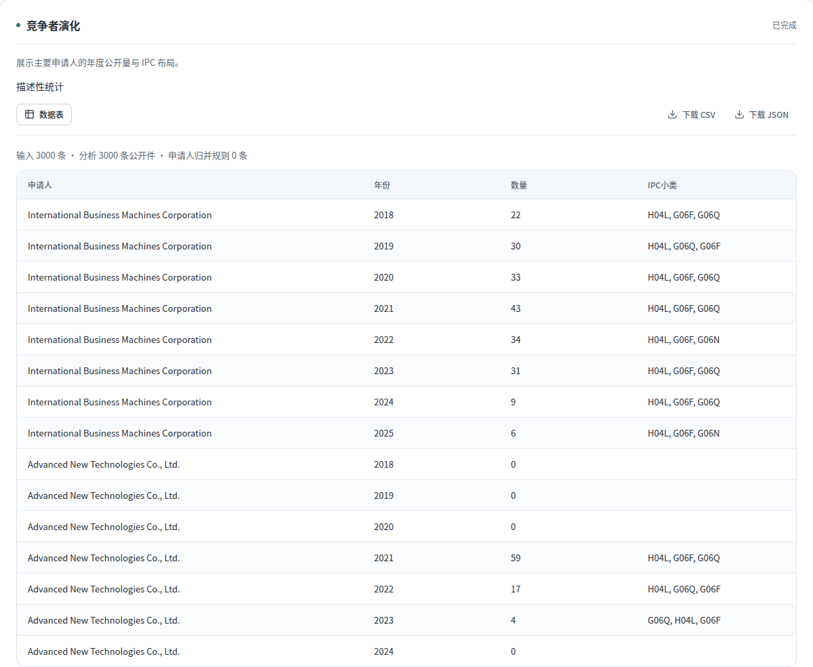

手机截图

## 布局变化的解释

数量和IPC排名变化提供研究线索，也可能来自名称变更、资料补录或样本构成。不能只凭高频分类变动证明战略转型。未测量企业投入、产品收入及市场份额，这些判断需要其他资料。

### 示例请求

> 比较主要申请人的技术分类布局随年份的变化，展示竞争者演化。

在应用中点击“直接运行示例”，在查询工作台按演示参数运行该工具，结果显示在本页；点击“填入示例并打开功能”则只打开参数表单，确认后点击“运行分析”。如需功能解释，可单独点击“询问助手”。

---

# 27 申请人集中度

申请人集中度描述专利数量在主体间的分配，用于比较样本组织结构。指标衡量样本专利份额，不能据此认定市场集中度或垄断程度。

自部署应用中的章节路由：`#guide/analyze_concentration`（登录后使用）。

## 分数计数与指标

多申请人专利在其申请人间等分贡献。CR3、CR5和CR10为头部相应主体的累计份额。HHI是份额平方和，采用0—1尺度。有效主体数采用Shannon熵指数 exp(−Σpᵢ ln pᵢ)，不是1/HHI。

## 计算和比较集中度

在同一技术范围与公开时段运行集中度。跨期比较保持口径及名称规则一致，避免集团归并变化影响主体数。数据表提供记录数、主体数与各指标，比例和百分数需区分。

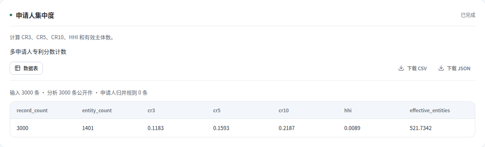

手机截图

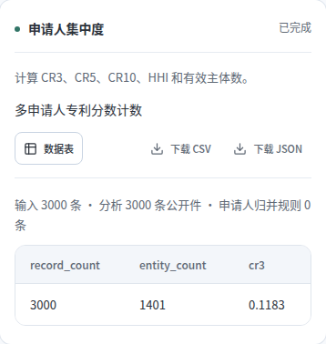

## 集中程度与均衡程度

CR描述头部份额，HHI描述整体分布。有效主体数表达分布均衡程度，通常不等于名称数。集中度较高仅表示该语料更多集中于少数主体，不能直接证明其技术能力更强。合作署名及筛选方式均影响结果。

### 示例请求

> 计算这批专利的申请人集中度，解释CR3、CR5和HHI的含义。

在应用中点击“直接运行示例”，在查询工作台按演示参数运行该工具，结果显示在本页；点击“填入示例并打开功能”则只打开参数表单，确认后点击“运行分析”。如需功能解释，可单独点击“询问助手”。

---

# 28 申请人合作网络

合作网络以专利中同角色主体共现建立联系，用于识别共同申请或共同发明。公开记录的署名关系不能覆盖全部产业合作。

自部署应用中的章节路由：`#guide/analyze_co_network`（登录后使用）。

## 节点、边及权重

申请人维度以申请人名称为节点，发明人维度以发明人为节点。一项专利的不同主体两两连边，权重是共同出现的专利数。申请人和受让人不混合作为同一角色。

## 查看合作结构

选择主体维度和范围后运行，查看连通结构、边权与数据表。打开共同署名专利核对合作方。没有多主体记录时可有节点无边，这属于有效统计。

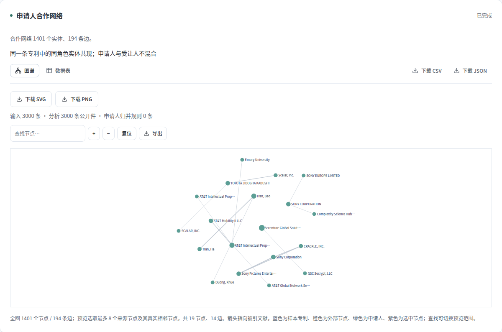

手机截图

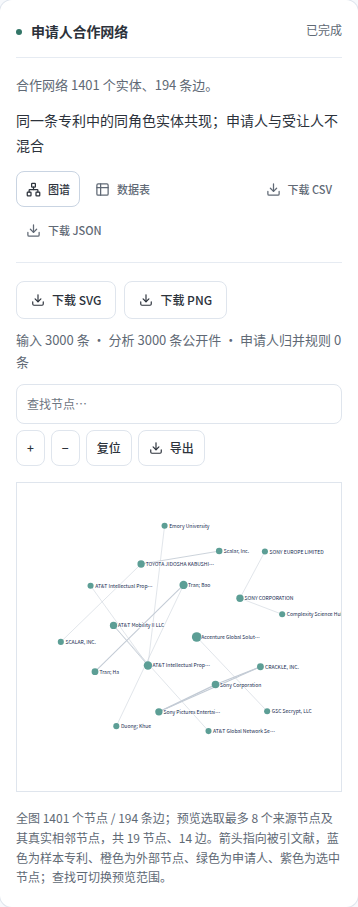

## 关系与名称规范

共现支持共同署名的文献关系，不能单独证明资本关联、研发合同或技术转移。不同拼写和实体拆分影响网络，名称归并需要来源支持。节点可视化中心位置不等于未计算的中心性指标。

### 示例请求

> 分析这批专利的申请人合作关系，展示合作网络和主要合作方。

在应用中点击“直接运行示例”，在查询工作台按演示参数运行该工具，结果显示在本页；点击“填入示例并打开功能”则只打开参数表单，确认后点击“运行分析”。如需功能解释，可单独点击“询问助手”。

---

# 29 引证、共引与文献耦合

引证分析研究文献引用联系。直接引证记录方向，共引表示两项文献被共同引用，耦合表示两项文献具有共同参考文献，三种关联具有不同含义。

自部署应用中的章节路由：`#guide/analyze_citation_network`（登录后使用）。

## 网络和PageRank

边从引用文献指向被引用文献。范围内被引用节点为内部节点，范围外编号作为外部节点保留。程序计算阻尼0.85、40轮PageRank。排名依赖当前图结构，未使用全行业完整引证。

文献耦合的shared为两项专利共同参考文献数，共引的count为共同引用该文献对的记录数。二者各返回排名前30对，引用网络则保留实际构建的边。引用编号经规范化匹配，种类代码不用于引证对比；原文读取仍按完整公开版本区分。

## 读取网络和文献对

先核对内部与外部边数，再查看图谱与排名。数据表 bibliographic_coupling 为共同引用参考文献，co_citation 为被共同引用。点击内部编号读原文，外部节点可能仅有编号而无入库全文。

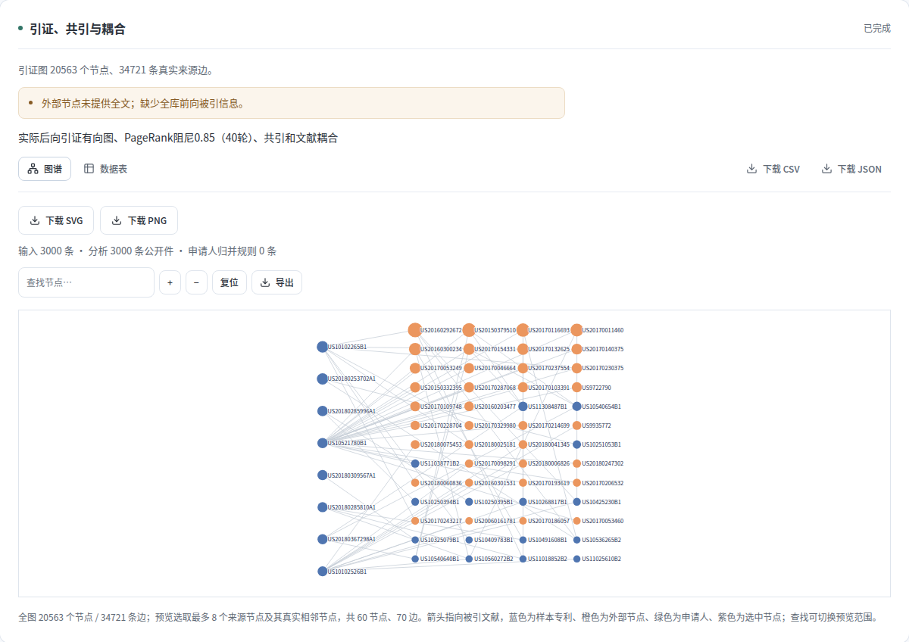

手机截图

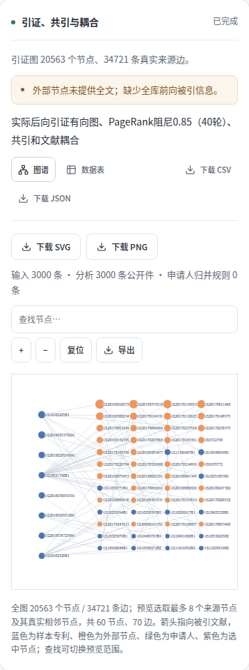

## 引证关联的研究用途

直接引证用于追踪相关先前文献，耦合用于寻找参考基础相近的方案，共引用于识别在引用文献中共同讨论的对象。引用不能自动证明技术继承、权利范围相似或正面评价。内部被引和PageRank受样本边界影响，不能替代全库影响力。

### 示例请求

> 展示这批专利的引证网络，分析共引和文献耦合，区分内部与外部引用。

在应用中点击“直接运行示例”，在查询工作台按演示参数运行该工具，结果显示在本页；点击“填入示例并打开功能”则只打开参数表单，确认后点击“运行分析”。如需功能解释，可单独点击“询问助手”。

---

# 30 引证技术主路径

主路径提取时间有序内部引证图中的高路径权重连接，用于组织样本文献的关联阅读次序。该方法依据引用与公开日期，不提供完整行业路线或因果演化证明。

自部署应用中的章节路由：`#guide/analyze_tech_roadmap`（登录后使用）。

## 时间方向与SPC

合格引证反向为早期公开文献指向后期，排除自引、缺日期、同日或时序不一致的边。SPC为源至边起点路径数乘以边终点至汇路径数。每个连通分量用动态规划选择SPC总和最大的源—汇路径。

## 提取并核对主路径

选择有引证资料的范围，运行后检查参与文献数和排除边数，查看主路径标记及边权。沿路径比较文献内容和引用语境。缺少符合时序的内部边时返回不可计算，不使用年度主题替代引证主路径。

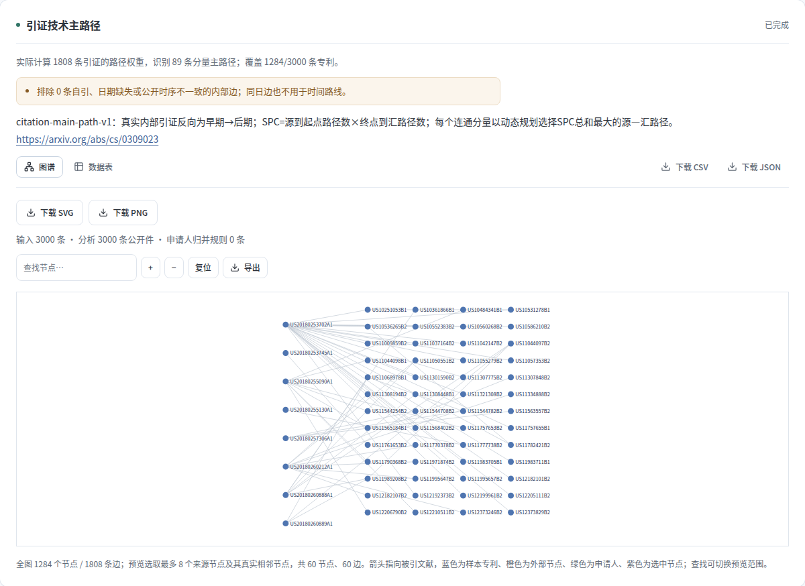

手机截图

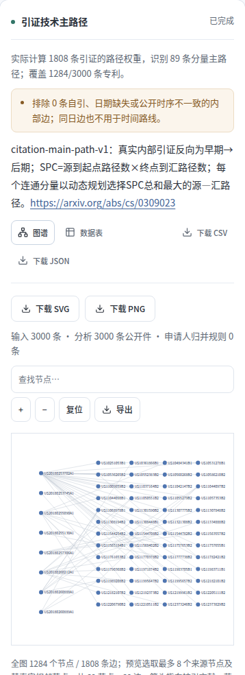

## 路径权重与技术关系

高SPC表示连接经过较多源—汇路径，不能直接解释为技术贡献较大。多个分量可以各有主路径，孤立记录不一定参与。路径受样本及引证缺失影响，不能证明后项继承前项发明；技术史解释仍需全文比较。

### 示例请求

> 根据真实引证关系提取技术主路径，展示路径图及对应专利，不把引证解释为因果。

在应用中点击“直接运行示例”，在查询工作台按演示参数运行该工具，结果显示在本页；点击“填入示例并打开功能”则只打开参数表单，确认后点击“运行分析”。如需功能解释，可单独点击“询问助手”。

---

# 31 引证指标筛查

引证筛查依据样本内部被引数和PageRank整理后续阅读对象，采用非支配分层。该功能不生成加权价值评分，也未执行单项专利商业估值。

自部署应用中的章节路由：`#guide/analyze_patent_valuation`（登录后使用）。

## Pareto非支配分层

一项专利在两个指标上均不低于另一项且至少一项较高时，前者支配后者。第一层为未被支配项，移除该层继续分层。同层按公开编号排序，不声明层内高低。

## 筛选和读取文献

设置范围及返回数，查看非支配层、内部被引与PageRank，再读取具体方案。来源权属事件和组合交易仅作背景；登记事件不等于成交，组合金额不得按数量分摊。

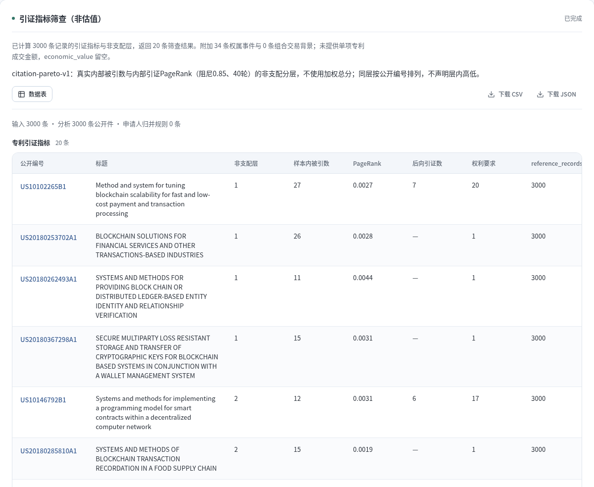

手机截图

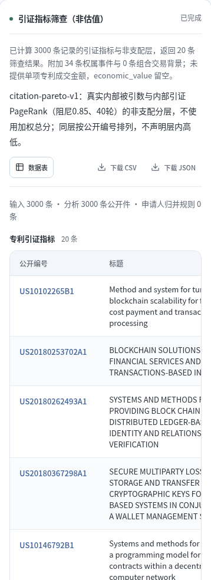

## 筛查与商业评估

层级只概括两个引证指标，不是质量或价值等级。收益、交易及维护成本未纳入计算，缺失引用不等于无引用。需要分别核对技术内容、状态及同族后，提出进一步专业评估问题。

### 示例请求

> 按引证指标筛选值得进一步复核的专利，展示指标依据，不输出商业估值。

在应用中点击“直接运行示例”，在查询工作台按演示参数运行该工具，结果显示在本页；点击“填入示例并打开功能”则只打开参数表单，确认后点击“运行分析”。如需功能解释，可单独点击“询问助手”。

---

# 32 科学论文关联

科学论文关联显示专利引用了哪些科学论文，用于研究科学与技术之间的知识流动。数据来自外部开放数据集，不由本系统从原文抽取，也不覆盖全部专利。

自部署应用中的章节路由：`#guide/external`（登录后使用）。

## 数据来源与许可

专利—论文引用关系来自 Reliance on Science（Marx 与 Fuegi 维护的公开数据集），包括专利首页引文和正文引用，每条关系带1—10的置信度；该数据采用 CC BY-NC 4.0 许可，限非商业使用。论文标题、年份、期刊和被引次数来自 OpenAlex（CC0）。USPTO 书目、被引专利和年费维持数据需要 API 密钥，当前部署没有导入。

## 数据集覆盖率

在数据与证据页面，当前数据集信息下方的“外部参考数据”列出关联科学论文、书目信息、被引专利和年费维持四类数据各覆盖多少个编号，以及已核对的编号数和来源版本。当前导入按美国专利编号匹配，其他公开局的记录不计入。没有关联记录可能是专利确实未引用论文，也可能是数据集未收录，不能当作“未引用科学文献”的证据。

## 专利的关联论文

打开任意专利原文，有关联记录时会显示“关联科学论文”，按置信度和被引次数排序，显示年份、期刊、被引次数、引用位置和置信度，点击标题打开DOI或OpenAlex页面。同一论文在首页和正文都被引用时合并为一条。OpenAlex没有元数据的论文只显示编号。

## 解释边界

论文关联反映专利文件中的引用，不代表发明直接源自该论文。被引次数取自获取时的 OpenAlex，会随时间变化。比较不同专利的科学关联强度时，应考虑不同申请人和审查员的引用习惯，并记录数据版本。

---

# 33 同族地域分析

同族地域按来源成员编号描述公开局分布，用于核对已有跨地域申请资料。结果受来源同族定义和覆盖影响，部分成员不能用于推断完整全球布局。

自部署应用中的章节路由：`#guide/analyze_family_geography`（登录后使用）。

## 同族标识和成员

familyId用于归组，familyMembers提供成员编号。程序去重已有编号再按局前缀统计，同时保留专利—成员对应及获取时点。缺成员记录不当作零同族。

## 核对成员和地域

先比较有资料记录数与总量，再查看地域和逐条成员。Google Family Applications及Country Status可能只提供申请或公开局代表件，应查来源定义，不视为全部公开版本。

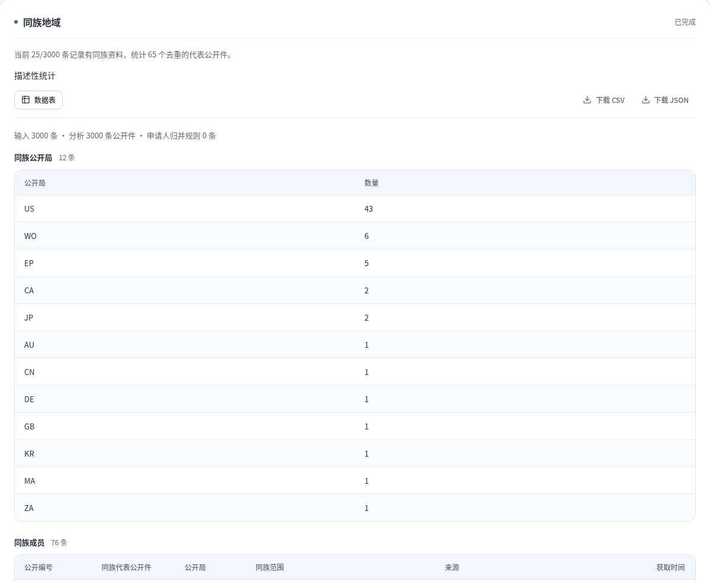

手机截图

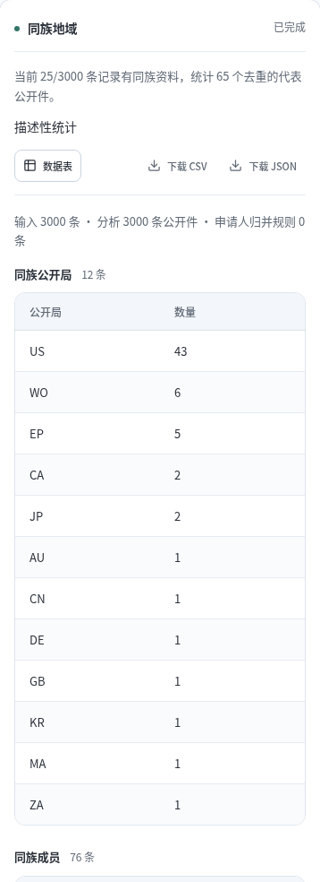

## 公开地域与权利地域

存在某局成员表示来源中有申请或公开关联，不表示该地当前有效。申请状态、版本和事件需分别核对。当前资料未保证所有成员及最新状态，报告应注明子集及定义。

### 示例请求

> 分析已有真实同族信息的地域分布，说明同族范围与缺失覆盖。

在应用中点击“直接运行示例”，在查询工作台按演示参数运行该工具，结果显示在本页；点击“填入示例并打开功能”则只打开参数表单，确认后点击“运行分析”。如需功能解释，可单独点击“询问助手”。

---

# 34 来源时点法律状态统计

法律状态统计整理获取时点的来源声明及事件，用于研究记录中已有法律资料。未进行官方效力核验，不能直接用于侵权或自由实施判断。

自部署应用中的章节路由：`#guide/analyze_legal_status`（登录后使用）。

## 状态与日期

同时有状态和获取日期的记录参与统计。as_of为获取时点，event_date为事件日期，预计到期日是另一概念。Active等第三方推定状态不能表述为官方确认有效。

## 查看状态构成

先核对有资料数量与总量，再读取分类及事件明细，回查来源与日期。其余缺资料记录为未知，不自动归入失效或审查中。

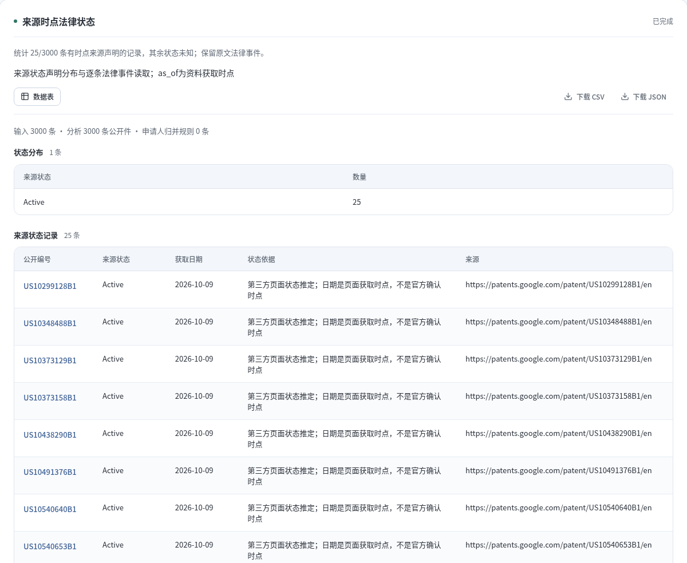

手机截图

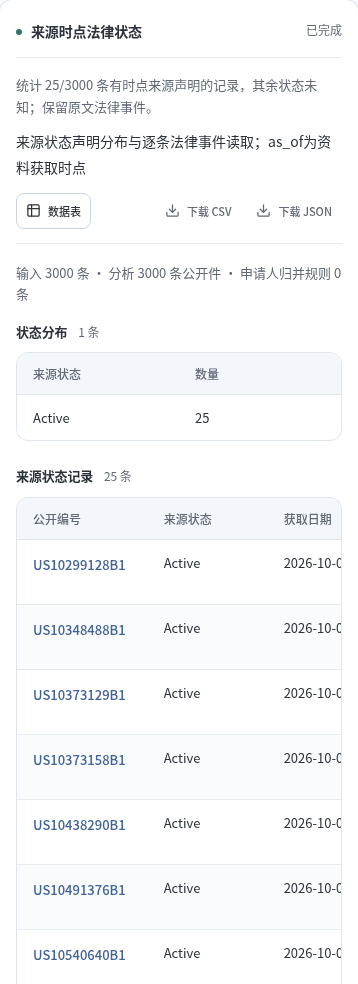

## 状态声明的解释

状态构成只描述已覆盖子集，不能作为整个语料有效比例。名称变更、合并及权属登记不自动证明当前所有权或交易价格。法律判断需要具体管辖地域、权利版本及最新官方程序资料。

### 示例请求

> 统计已有来源时点法律状态，标明未知记录、获取日期和第三方状态限制。

在应用中点击“直接运行示例”，在查询工作台按演示参数运行该工具，结果显示在本页；点击“填入示例并打开功能”则只打开参数表单，确认后点击“运行分析”。如需功能解释，可单独点击“询问助手”。

---

# 35 权利要求要素抽取

要素抽取将指定版本的权利要求分解为技术要素和关联，用于整理方案及准备文献对照。结果保留引句与偏移，供逐项核查。

自部署应用中的章节路由：`#guide/analyze_claim_elements`（登录后使用）。

## 条款范围与证据定位

输入范围内编号，默认处理全部权利要求，可明确选择条款号。模型读取分段文本，程序核对引句在对应条款中逐字定位。独立和从属条款的依赖分别记录，不用条款数量评价质量。

## 执行要素抽取

选择原文完整版本，填写编号及可选条款号。完成后逐行核对标签、引句和关联，再读上下文。长文本分段读取并保存完成段，标签不能替代条件、数量及连接关系。

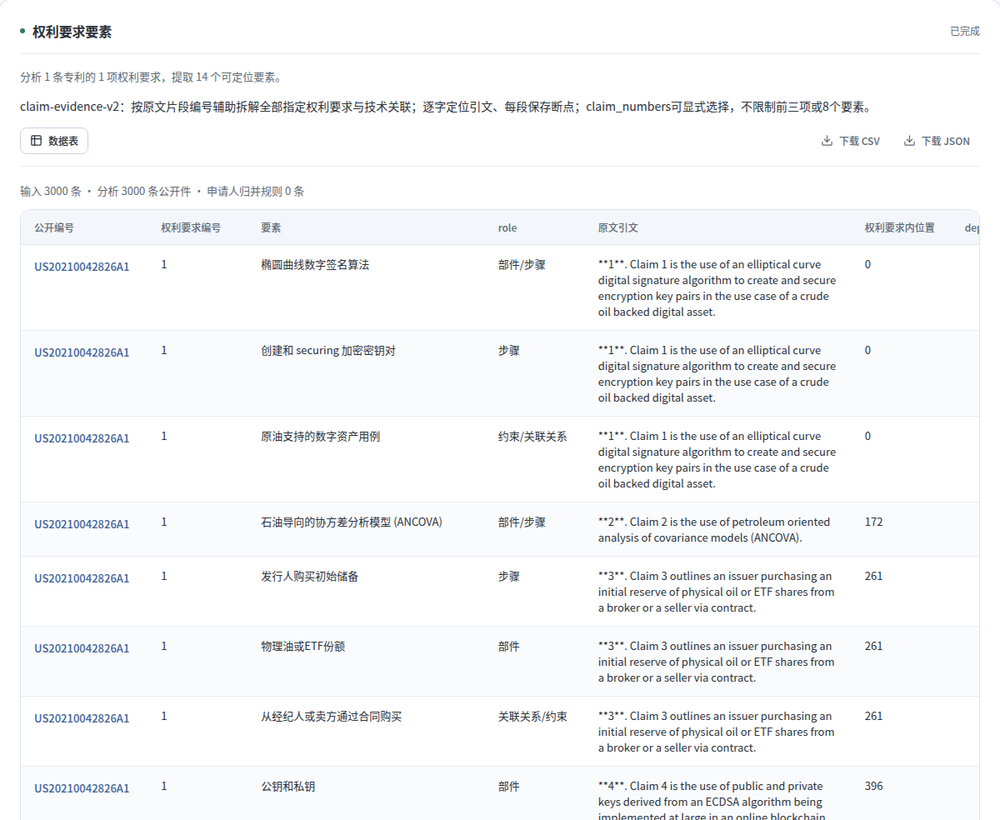

手机截图

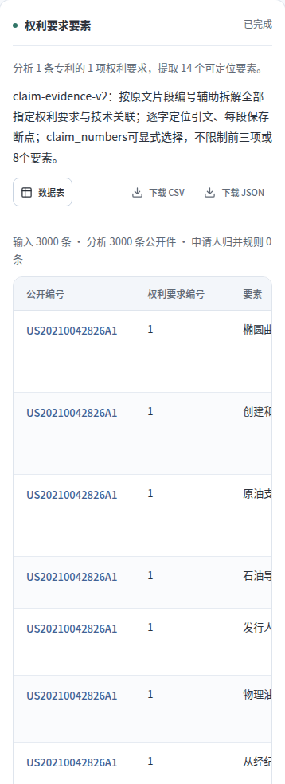

## 技术特征与权利范围

表格可组织技术特征清单。定位仅证明出处，不保证解释正确。权利范围需要完整条款、说明书及法律规则，当前不输出侵权、新颖性或FTO意见。未抽出要素也不能证明原文不存在。

### 示例请求

> 选取一项原文完整且篇幅适中的专利，拆解全部权利要求的技术要素与依赖关系，逐项给出原文定位。

在应用中点击“直接运行示例”，在查询工作台按演示参数运行该工具，结果显示在本页；点击“填入示例并打开功能”则只打开参数表单，确认后点击“运行分析”。如需功能解释，可单独点击“询问助手”。

---

# 36 权利要求对照

权利要求对照以一项专利为基准比较其他文献，形成双侧原文证据表，用于研究技术方案差异。未执行法律侵权或新颖性评价。

自部署应用中的章节路由：`#guide/compare_claims`（登录后使用）。

## 基准与版本

至少两个不同编号，第一个为基准。推荐默认第1项条款，可指定其他号。缺文献不跳过或自动更换，运行前确认版本及范围。

## 建立逐项对照

选择对象相近、原文完整的文献，填写顺序与条款号。核对基准要素和目标引句，阅读相同、部分重合及未发现三类记录。部分重合需比较条件与连接，不只比较名称。

手机截图

## 匹配结果的解释

匹配为模型辅助语义结果，需核对双侧文本。未发现仅表示指定条款未找到对应，不推广为说明书或全球现有技术缺少。未应用全要素规则，未纳入审查档案及效力，不能断言侵权或可自由实施。

### 示例请求

> 选取两项原文完整且篇幅适中的专利，对照第1项权利要求，逐项列出技术要素的重合、差异和原文证据，不作侵权判断。

在应用中点击“直接运行示例”，在查询工作台按演示参数运行该工具，结果显示在本页；点击“填入示例并打开功能”则只打开参数表单，确认后点击“运行分析”。如需功能解释，可单独点击“询问助手”。

---

# 37 技术效果矩阵

技术效果矩阵抽取全文中明确陈述的措施—效果关系，用于整理方案如何解决技术问题。矩阵呈现文本声明，不能表示效果已经独立实验验证。

自部署应用中的章节路由：`#guide/analyze_tech_matrix`（登录后使用）。

## 全文读取与关系抽取

读取全部摘要、权利要求及说明书，16000字符分段、1000字符重叠。模型按片段标识提取关系，程序取回并校验连续引句。标签依据文本生成，不使用预设关键词共现代替抽取。

## 选择分析对象

推荐选择一项完整且篇幅适中的文献。扩大范围时明确编号。运行后从矩阵和数据表核对技术、效果及证据，区分抽取关系与来源实验结果。

手机截图

## 关系覆盖与来源声明

没有明确陈述的段可返回空结果，不补造关系。相似标签尚未人工归并。每段成功后保存断点，相同参数重跑复用已完成段；中断的部分输出不能当作全文覆盖。逐字定位证明出处，效果真伪及适用条件仍需其他验证。

### 示例请求

> 选取一项原文完整且篇幅适中的专利，完整读取摘要、权利要求和说明书，提取技术与效果并生成矩阵，保留原文证据。

在应用中点击“直接运行示例”，在查询工作台按演示参数运行该工具，结果显示在本页；点击“填入示例并打开功能”则只打开参数表单，确认后点击“运行分析”。如需功能解释，可单独点击“询问助手”。

---

# 38 技术全景研究

技术全景研究将分类、时间、主体和主题分析组织为同一研究范围内的连续任务，用于形成领域文献结构及代表方案的研究报告。

自部署应用中的章节路由：`#guide/landscape-workflow`（登录后使用）。

## 范围准备与候选确认

在专业任务入口选择技术全景，填写研究目标、数据集、公开年份与IPC条件。范围准备统计实际记录及字段问题；确认后建立候选。未指定主题表达时保留结构筛选范围，指定主题表达时采用语义召回并记录返回上限。检查候选与目标相符后再确认。

## 统计与原文证据

后台依次保存公开趋势、IPC、年度关键词、主题聚类及申请人组合，结果采用同一确认范围。证据阶段从统计结果关联中选取代表文献并读取原文，保存编号、字段及位置。代表集合具有数量边界，报告不应将其当作全部文献的全文审读。

## 全景报告的比较条件

报告结合真实统计和保存证据生成正文，图表关联当次结果。先核对研究范围与候选限制，再比较时间分布、主体结构和主题内容。重算前序范围会使下游产物过期；仅重新生成报告时复用已确认统计，不改变原统计条件。

### 使用实例

> 研究当前数据集近期公开文献的技术分类、主要主题和申请人布局，结合代表文献生成技术全景报告。

在应用中点击“填入示例并打开功能”，进入对应专业任务的创建表单。数据集及参数自动填入，可修改后点击“创建并准备首阶段”；跳转不提交任务。

---

# 39 竞争主体专题研究

竞争主体研究以确认的申请人名称建立可比较集合，分析各主体的公开活动、分类组合及共同申请关系。主体名称与实际竞争关系需分别判断。

自部署应用中的章节路由：`#guide/competitor-workflow`（登录后使用）。

## 主体名称确认

选择竞争主体任务，逐行填写目标名称。系统给出来源中的完全匹配及近似名称，近似候选需人工选择，不能自动认定为集团成员。保存名称映射后确认；没有匹配的主体保留未匹配状态，不用全库代替其记录。

## 统一范围与主体统计

设置相同的年份、IPC和计数口径，确认范围与候选后执行组合、年度演化及合作网络。目标主体统计与共同署名合作方分别呈现。多主体专利可以进入多个组合，主体计数之和不能作为去重后的专利总量。

## 竞争报告的使用

先检查名称覆盖及每个目标主体的匹配数量，再比较类别侧重和跨年变化。共同申请支持署名关系，不能单独证明商业联盟。报告中的布局判断仅适用于本次来源和范围，缺失名称或样本偏差应保留在比较结论中。

### 使用实例

> 选取当前数据集中的两个申请人，比较公开趋势、技术分类组合及共同申请关系，生成竞争主体报告。

在应用中点击“填入示例并打开功能”，进入对应专业任务的创建表单。数据集及参数自动填入，可修改后点击“创建并准备首阶段”；跳转不提交任务。

---

# 40 技术方案查新

技术方案查新从待研究方案提取特征，组织检索策略并逐特征比较候选原文，形成有出处的技术对照底稿。该流程辅助现有技术研究，不出具法定查新或专利新颖性结论。

自部署应用中的章节路由：`#guide/novelty-workflow`（登录后使用）。

## 方案特征与检索策略

输入方案文本，或从项目材料及已完成OCR页创建任务。模型提取部件、步骤、约束和关系，保留方案引文。检查并保存特征后确认，再编辑和确认多条检索策略。布尔表达式用于明确词项关系，语义表达用于概念召回，两者的得分与命中范围分别记录。

## 候选选择和逐特征对照

各策略在指定年份和IPC范围内执行，按公开编号合并候选并保留命中路径。选择候选后执行全文对照，逐件、逐批片段记录支持、部分对应或未找到对应，并保留证据引文。可以调整解释和对应状态，支持或部分对应需选择实际原文证据；修改保存后再确认底稿。

## 对照报告的证据边界

报告读取已确认底稿，引用保存的原文，不自行重判对应关系。“未找到”限于已提供片段与本次候选，不能推广为全球现有技术不存在。核对主体、对象、动作及关系是否一致，不能将术语共现认作技术特征相同。检索覆盖和法律判断仍需另行处理。

### 使用实例

> 以分布式账本数字身份认证方案为演示输入，提取技术特征，确认检索策略和候选专利，再逐特征比较原文。

在应用中点击“填入示例并打开功能”，进入对应专业任务的创建表单。数据集及参数自动填入，可修改后点击“创建并准备首阶段”；跳转不提交任务。

---

# 41 专利布局研究

专利布局研究整理代表文献中的技术措施与效果关系，在确认的证据矩阵上提出可进一步研究的方向。方向建议属于研究候选，不是已经验证的可专利方案。

自部署应用中的章节路由：`#guide/layout-workflow`（登录后使用）。

## 文献选择与关系矩阵

选择专利布局任务，限定数据集、年份及技术范围，确认候选和代表文献。系统读取原文并抽取措施—效果关系，保存字段及引文位置。检查矩阵中每项关系是否由文献明确陈述，缺失效果保持缺失，不以常识补齐。

## 方向选择和阶段保存

结合目标、约束及证据选择候选方向，编辑内容后保存，再确认继续。可以取消全部方向，仅让报告汇总已有证据；没有选中方向不等于执行失败。保存失败时保留待编辑内容，未保存的修改不能作为已确认产物使用。

## 布局报告的研究含义

报告区分来源措施、原文声明效果及模型建议。建议可用于后续方案设计与检索验证，不能因矩阵某格为空便认定存在可授权的技术空白。技术可行性、权利范围及新颖性需分别验证，本流程不宣称自由实施。

### 使用实例

> 研究数字身份认证中的技术措施与效果关系，结合原文矩阵提出并选择可进一步验证的研发方向。

在应用中点击“填入示例并打开功能”，进入对应专业任务的创建表单。数据集及参数自动填入，可修改后点击“创建并准备首阶段”；跳转不提交任务。

---

# 42 数据变化监测

变化监测比较同一范围与检索条件下的两次入库返回集，用于记录资料更新。它不自动获取互联网新增专利。

自部署应用中的章节路由：`#guide/monitor_patent_changes`（登录后使用）。

## 基线与变化类型

首次建立基线，收录不标为新增。再次比较编号和规范字段，输出新增、移出及记录变化。零变化为正常结果。向量副本、原文副本与偏移不作为变化依据。

## 建立监测策略

填写表达与策略ID，例如 blockchain 和 blockchain-monitor，设定范围及数量。导入或编辑后用相同参数重跑。数据集、范围或条件改变时建立独立基线，不互相比作新增移除。

手机截图

## 集合变化的含义

新增可以来自导入、字段修改或排名变化，不必是新公开专利。移出不表示失效或从全球库删除。读取变化字段与来源后，再决定是否更新研究报告。

## 订阅、来源更新与通知

监测订阅按设置的间隔由后台执行，可暂停、恢复或立即运行，结果变化保存为站内通知。修改检索范围形成新策略版本并重新建立基线。数据页面可提交指定DLT源窗口更新，查看下载进度、入库批次和记录版本；已有手工修改与新来源冲突时拒绝覆盖。配置来源更新计划后可由后台调度，覆盖仍限于指定来源和窗口，不是全球实时扫描。

### 示例请求

> 为blockchain检索建立数据变化监测基线；已有基线时报告新增和移除记录。

在应用中点击“直接运行示例”，在查询工作台按演示参数运行该工具，结果显示在本页；点击“填入示例并打开功能”则只打开参数表单，确认后点击“运行分析”。如需功能解释，可单独点击“询问助手”。

---

# 43 综合分析流程

综合分析在同一范围内连接统计结构、技术主题和全文证据。图表间对应关系用于组织研究问题，而非仅并列多个输出。

自部署应用中的章节路由：`#guide/demo`（登录后使用）。

## 结构分析与代表文献

先检查数据概况和IPC，再比较主体组合与主题聚类。核对主题代表文献的共同措施；加入引证网络研究引用关联，避免把数量排名等同于核心技术。

## 全文与报告

选代表专利拆解权利要求或抽取措施—效果。查询工作台的“综合分析”按钮在本页依次运行数据概况、申请人组合、技术主题聚类、引证指标筛查、引证网络和权利要求要素，当前数据缺少字段的工具不运行；这一步只计算，不撰写报告。需要成文报告时，在分析助手输入下面的问题，或点击本章“直接运行示例”：

> 分析当前数据集的主要申请人、技术主题和代表专利，展示引证关系，并拆解一项代表专利的权利要求，生成报告。

## 结果保存

完成后保存报告，可导出Markdown和独立交互HTML，工具数据可下载JSON，图表可下载SVG或PNG。HTML包含公式字体与完整结果，离线可切换视图、指标、年份和显示数量。历史结果不随数据切换而重算，图表关联当次工具结果，公开编号关联原文。

### 示例请求

> 分析当前数据集的主要申请人、技术主题和代表专利，展示引证关系，并拆解一项代表专利的权利要求，生成报告。

在应用中点击“直接运行示例”，把该问题发给分析助手；点击“填入示例并打开功能”只把问题放入输入框，不发送。如需功能解释，可单独点击“询问助手”。

---

# 44 分析助手

分析助手将自然语言要求转换为工具计划并解释真实结果。功能咨询查阅说明书，数据分析才执行工具，二者分别记录。

自部署应用中的章节路由：`#guide/assistant`（登录后使用）。

## 研究要求与执行计划

请求说明研究对象、公开时间及方法。当前语料统计写明当前数据集；按分类研究时直接限定IPC和年份，不将分析方法名用作待检索技术主题。具体用途的问题可先检索。明确工具应列入计划，工具输出独立保存，报告失败不使已完成结果丢失。

## 功能和方法咨询

可询问“生命周期统计采用什么模型，参数如何解释？”或“文献耦合与共引有何区别，如何操作？”。回答依据说明书并提供链接，不声称已计算，也不编造当前结果。

手机截图

## 事实准备和流式报告

发送后立即建立对话反馈，可展开查看范围确定、工具执行及报告准备过程。程序先计算指标并保存证据，再把上下文交给模型流式撰写，正文遇到结果引用时展示对应图表。过程记录是执行状态，不是模型内部思维。结果接口保留完整数据与分页入口，报告使用预览时记录省略范围，不能将未传入的行写成工具缺失。

## 补充检索与报告审计

限定领域的问题先检索，再由模型复核候选范围：可提出新的检索词，最多补充检索两轮；剔除的候选保存理由，范围说明中注明需要人工复核。统计类工具完成后，权利要求要素、权利要求对照和引证网络并行执行。报告写完后，程序逐段核对正文中的公开编号、数值和图表引用能否在本次工具结果中找到，数值允许按正文显示的精度四舍五入。发现问题时，模型按问题清单修改一次；仍未通过的条目列在报告末尾“自动审计待复核问题”中，需要人工核对。审计只检查是否有出处，不判断结论是否正确。

## 研究问题与后续追问

首页问题根据当前数据集和可执行工具生成，预先缓存多批，换组后后台补充。完成回答后生成五个相关追问，逐条呈现，可换一批；推荐只表示可以继续研究，点击后仍需执行工具。研究要求可设置模型调用预算，预算耗尽保留已完成结果，调用次数不等于费用。

## 对话记录

在助手顶部打开分页历史，点击条目恢复所属数据集的对话。新对话建立新的研究记录，继续上轮候选需明确说明。后台持久任务不因关闭页面停止，失败或取消后按保留进度恢复；刷新读取保存的状态，不重复提交。更新资料后重新运行才能获得新统计。

### 示例请求

> 检索当前数据集中与数字身份认证相关的专利，统计近年的公开趋势和主要申请人，并说明结果的适用范围。

在应用中点击“直接运行示例”，把该问题发给分析助手；点击“填入示例并打开功能”只把问题放入输入框，不发送。如需功能解释，可单独点击“询问助手”。

---

# 45 报告与研究记录

研究记录保存问题、参数和计算结果，用于复现及回查。对话历史记录过程，报告库保存已归档输出。

自部署应用中的章节路由：`#guide/history`（登录后使用）。

## 对话与报告库

在分析助手打开历史并分页查找。重命名只修改标题，删除对话不删除已保存报告。运行完成与保存报告是两个动作，需主动归档。以“工具 ·”开头的记录来自查询工作台，打开后回到工作台显示结果。

手机截图

## 导出和版本比较

Markdown导出正文，HTML保留交互图表、公式与完整工具结果，可离线阅读；JSON保留结构化结果。词云、图表、聚类和图谱均可下载SVG或PNG。报告和对话支持单条与勾选批量删除，删除对话不删除已保存报告，删除报告不删除原对话。旧报告为当次快照，不随数据编辑改变。比较新旧分析需记录双方范围和参数。

## 协作修订与发布版本

报告支持草稿修订、批注及发布快照，分享读取授权版本。修改草稿不覆盖已发布版。专业任务可以重新生成报告，保留先前产物及来源阶段版本；先确认上游范围和证据是否仍有效，再决定修订文字或重新计算。Word和PDF用于版面交付，交互操作保留在HTML中。

## 原文回查条件

数据库原文依赖对应数据集。删除数据集后报告仍可阅读，原文入口可能不可用；来源公开链接可用于另行回查。

## 逐条复核结论

报告库中每份报告都有“逐条复核”入口，打开报告后也可以在“报告正文”和“逐条复核”之间切换。复核把报告拆成段落逐条判断，只记录判断，不修改报告正文；操作和统计口径见“结论复核与检索实验”一章。

---

# 46 结论复核与检索实验

结论复核记录研究人员对报告每条结论的判断，检索实验记录一次检索的方法、用时和命中，两者都用于评价人机协同的可靠性和效率。系统只保存人工判断和计算指标，不替研究人员判断结论是否正确。

自部署应用中的章节路由：`#guide/review`（登录后使用）。

## 打开逐条复核

在报告库点击某份报告的“逐条复核”，或打开报告后切换到“逐条复核”标签。页面按段落列出结论条目，每条显示所属章节、正文中的公开编号和关联的工具结果；点击编号打开专利原文。顶部可以筛选全部、待复核和已复核条目。草稿修订后，复核针对当时打开的版本。

## 记录判断与理由

点击“开始复核”后选择采纳、修改或驳回。修改和驳回必须填写理由，修改时同时填写修改后的结论；可以勾选实际核对过的工具结果，补充人工找到的公开编号。提交后不可覆盖，需要改判时点击“重新复核”新建一条记录。耗时从点击“开始复核”算起，暂不提交的记录下次可以继续。只读成员可以查看条目和统计，不能提交。

## 复核统计

页面顶部汇总已复核条目数，以及采纳、修改、驳回比例和平均耗时；展开后按章节和工具分组。同一复核人对同一条只计最后一次提交。一条结论关联多个工具时分别计入各组，各组条数不能相加。统计反映本项目成员的判断，样本较少时不宜推广为模型整体准确率。接口和字段说明见仓库 docs/HUMAN-AI-REVIEW.md。

## 检索效率实验

报告库下方的“检索效率实验”用于比较AI检索和人工布尔检索。选择方法，填写查询式，点击“开始计时”后进行检索，完成时“结束计时”，再粘贴命中的公开编号并保存。刚在查询工作台运行过专利检索时，可以点击“填入工作台最近一次专利检索结果”带入查询式和命中编号。

## 对照参考集

在实验记录上点击“对照参考集”，粘贴人工判定的相关专利编号，计算查准率和查全率。比较按公开编号去重，不合并同族；参考集只用于本次计算，不保存。结果只相对于该参考集，不代表全球查全率。比较两种方法时应使用同一参考集，并记录检索人员和数据集。

---

# 47 模型配置

模型配置选择规划、主题命名和全文抽取使用的语言模型。嵌入模型负责检索索引，不能任意替换后沿用原向量。

自部署应用中的章节路由：`#guide/settings`（登录后使用）。

## 平台与组织模型

平台设置填写兼容接口地址、模型名及密钥，保存并测试连接。组织管理员从管理菜单进入组织模型，配置本组织提供商；未配置时沿用平台模型，删除组织配置恢复平台选择。组织密钥加密保存在服务端，界面不回显，编辑时留空保留旧密钥。更换模型可能改变规划和抽取解释，比较时应记录模型条件。

## 嵌入索引

当前使用text-embedding-v4和1024维向量，报告模型与嵌入分别配置。改变嵌入模型或维度需要重建全部索引，不混用向量空间。

## 计算、用量和预算

公开量、分类及网络由程序计算，语言模型不改变算法定义。主题名称、要素和效果关系是辅助解释，应结合原文，不以报告正文代替结构化结果。用量页面记录实际模型调用及提供方返回的token，调用预算限制执行次数。未返回用量的调用不能记作零成本，OCR服务费用与聊天、嵌入费用分别计算。

---

# 48 开放接口与MCP

项目开放接口允许外部程序和MCP宿主读取授权资料并提交分析任务。外部调用与网页使用同一工具和项目范围，不提供任意自然语言对应任意未实现功能的保证。

自部署应用中的章节路由：`#guide/integrations`（登录后使用）。

## 项目凭据和访问范围

从管理菜单打开接口凭据，选择读取或写入权限和有效期。密钥只在创建时显示，保存后可撤销。凭据固定绑定当前项目，角色降级或成员移除影响后续授权；只读凭据不能启动模型分析。不要将项目凭据与模型供应商密钥混用。

## 工具发现与持久任务

OpenAPI提供接口和输入字段，MCP支持stdio及HTTP传输。当前提供31项分析工具和7项资源、任务操作，共38项。外部宿主发现工具后按参数调用；耗时分析提交持久任务，读取进度和结果，停止需显式请求。断开宿主不会自动取消已经入队的任务。

## 结构化结果与证据读取

结果返回实际范围、状态、指标、逐行专利关联和原文证据。分页读取完整保存结果，图谱读取实际节点和边；预览省略不代表原始数据缺失。接入配置见仓库integrations/patent-mcp说明，公网HTTP端点为/mcp，使用项目Bearer凭据。模型仍需根据可发现工具选择操作，工具目录之外的能力不能由自然语言补造。

## 检索实验与外部参考数据

检索实验、结论复核和外部参考数据的网页功能都有对应接口：检索实验记录与参考集对照、报告结论条目与复核记录、数据集外部覆盖率，以及单件专利的关联论文。字段和权限见OpenAPI。外部参考数据为只读，接口返回来源版本和许可证；专利—论文关联数据限非商业使用。
